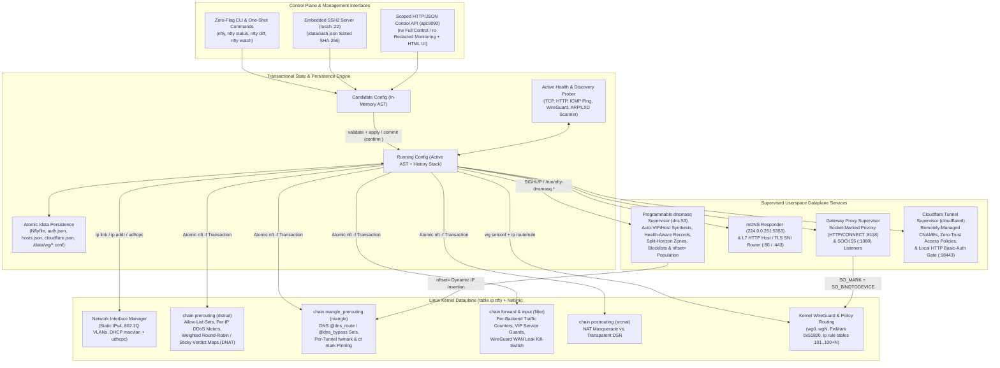

# `nfty` Documentation Hub

Welcome to the official documentation for **`nfty`** — a zero-dependency Linux L4/L7 service load balancer, virtual IP (VIP) appliance, programmable DNS endpoint, and policy-routing egress gateway (Direct Internet NAT or Multi-Tunnel WireGuard) written in Rust.

`nfty` compiles a human-friendly declarative configuration file (`/data/Nftyfile`), an interactive Cisco/VyOS-inspired hierarchical CLI, or a 1:1 HTTP/JSON Control API into atomic kernel `nftables` rulesets (`table ip nfty`). It is engineered to run either as a standalone daemon on existing Linux routers/servers or directly as `/sbin/init` (**PID 1**) inside a minimal LXD system container, UEFI unikernel VM, or bare-metal ARM64 / Rockchip RK3588S appliance.

---

## 📚 Documentation Table of Contents

| Guide | Description |
| :--- | :--- |
| **[1. Getting Started & Deployment Guide](./getting-started.md)** | Building from source (`glibc` & static `musl`), deploying across all 4 modes (Standalone Daemon, LXD Container, Bootable Unikernel VM/Bare-Metal x86_64, and Bare-Metal ARM64/RK3588S), first-boot SSH setup, and zero-flag CLI ergonomics. |
| **[2. `Nftyfile` Configuration Reference](./nftyfile-reference.md)** | Complete declarative syntax reference for `/data/Nftyfile`: global `allow` ACLs, static/VLAN/DHCP `macvlan` `vip` blocks, L4/L7 `service` blocks, `gateway` blocks, programmable `dns` blocks, and `no ...` negation rules. |
| **[3. Interactive CLI & Live TUI Guide](./interactive-cli-and-tui.md)** | Navigating Operational vs. Configuration modes, hierarchical drill-down contexts, Candidate vs. Running state workflows, automatic rollback timers (`apply confirm <secs>`), service discovery (`scan`/`adopt`), and the `watch` TUI dashboard. |
| **[4. HTTP/JSON Control API Reference](./api-reference.md)** | Enabling and scoping `api:<port>` on VIPs and Gateways, `ro` vs. `rw` API keys, key redaction security model, authentication methods, the embedded read-only web dashboard, and full `curl` endpoint schemas. |
| **[5. Programmable DNS, WireGuard Gateways & Cloudflare Tunnels](./dns-and-wireguard-gateways.md)** | Deep dive into `dnsmasq` supervision, health-aware DNS, split-horizon zones, `nftset` domain-based policy routing (`route`/`bypass`), multi-tunnel WireGuard ECMP gateways, inbound port forwards, `privoxy`/`socks5` proxies, and Cloudflare Zero-Trust Tunnels. |

---

## 🏗️ High-Level Architecture Overview

`nfty` separates control-plane state (**Candidate Configuration** vs. **Running Configuration**) from high-performance kernel and userspace dataplanes. Every configuration change is validated via an `nft -c -f` dry-run before atomically replacing `table ip nfty` in a single netlink transaction.

---

## ✨ Feature Matrix

| Capability | Subsystem | Highlights |
| :--- | :--- | :--- |
| **Virtual IP (VIP) Management** | `compiler.rs` / `unikernel.rs` | Static IPv4 VIPs (`169.254.10.10/24`), 802.1Q VLAN sub-interfaces (`vlan 20`), and named DHCP `macvlan` VIPs (`vip sonarr { dhcp eth0 }`) with deterministic MAC addresses and `udhcpc` hostname registration. |
| **Kernel L4 Load Balancing** | `table ip nfty` (`prerouting`) | TCP, UDP, or dual-stack (`both`) port forwarding; weighted `round-robin` (`numgen inc mod N`) or source-IP `sticky` (`ip saddr mod N`) verdict maps; `nat` (masquerade) or `transparent` (DSR/preserve client IP) modes; automatic `backup` backend failover. |
| **Active Health Checking** | `health.rs` | Periodic `tcp`, `http <path>`, and `ping` (ICMP) probes with sub-millisecond latency tracking. Unhealthy or manually `drained` backends are immediately removed from active kernel `nftables` maps and DNS responses without dropping existing flows. |
| **Dynamic Allow-Lists & Rate Limiting** | `table ip nfty` (`allow_*`, `meter_*`) | Global and per-service/per-gateway ACLs supporting exact IPs, CIDRs (`10.0.0.0/8`), IP wildcards (`169.254.1.*`), hostnames (`admin.office.lan`), and wildcard hostnames (`*.office.lan`). Kernel per-IP or global packet rate limiting (`limit 200/sec burst 100 per-ip`). |
| **L7 Host/SNI Proxy & Cross-VLAN mDNS** | `features/vhost_mdns.rs` | Shares ports `80` and `443` across multiple backend services on the same VIP by inspecting HTTP `Host` headers and TLS ClientHello `SNI` extensions. Includes an embedded multicast mDNS responder and cross-VLAN repeater (`224.0.0.251:5353`). |
| **Internet NAT & WireGuard Gateways** | `features/wireguard.rs` / `gateway_proxy.rs` | Virtual Gateway IPs (`gateway 169.254.10.20`) usable as a LAN default gateway. Operates in **Direct Internet NAT** mode or **WireGuard Multi-Tunnel ECMP** mode with per-tunnel `fwmark` routing tables, `ct mark` connection pinning, WAN leak `killswitch`, inbound port forwarding (`forward <port> to <ip:port>`), and built-in `privoxy:8118` and `socks5:1080` proxies. |
| **Programmable DNS (`dnsmasq` + `nftset`)** | `features/dns.rs` | Zero-downtime `dnsmasq` supervisor with automatic VIP/host `A` and `PTR` synthesis, health-aware record filtering, authoritative `a`/`aaaa`/`address`/`cname`/`txt`/`srv`/`mx`/`ptr` records, conditional split-horizon `forward` zones (optionally pinned `via <gateway>`), ad/tracker blocklists, and `nftset`-powered domain routing (`route <domain> via <gw>`, `bypass <domain> from <gw>`). |
| **Cloudflare Zero-Trust Tunnels** | `features/cloudflare.rs` | One-line `cloudflare-dns <fqdn>` provisions remotely-managed Cloudflare Tunnels, ingress rules, and proxied CNAME records. Supports Cloudflare Access email/domain policies (`cloudflare-auth *@example.com`) and built-in HTTP Basic Auth (`auth <user:pass\|nfty>`). |
| **Scoped Control API & Dashboard** | `api.rs` | Dynamic `api:<port>` listeners on VIPs and Gateways with `rw` (read-write) and `ro` (read-only) scoped API keys (`key new rw`, `key new ro`). Automatic secret redaction (`<redacted-rw-key>`) for `ro` consumers and a built-in dark-mode HTML status dashboard at `GET /`. |
| **PID-1 Unikernel & Container Appliance** | `unikernel.rs` / `ssh.rs` | Boots directly as `/sbin/init` in <200ms, mounts `/proc`, `/sys`, `/dev`, and persistent `/data`, runs an embedded SSH2 server (`russh`) with mandatory first-login password rotation, and provides a live `ratatui` terminal dashboard (`watch`). |

---

## 🚀 Quick Links by Use Case

- **I want to build `nfty` or deploy the appliance on LXD, QEMU, or an RK3588S board:**
  👉 Read **[Getting Started & Deployment Guide](./getting-started.md)**
- **I want to write or edit `/data/Nftyfile`:**
  👉 Read **[`Nftyfile` Configuration Reference](./nftyfile-reference.md)**
- **I want to use the interactive router CLI, `scan`/`adopt`, or the live `watch` TUI:**
  👉 Read **[Interactive CLI & Live TUI Guide](./interactive-cli-and-tui.md)**
- **I want to automate `nfty` via REST/JSON or generate `ro`/`rw` API keys:**
  👉 Read **[HTTP/JSON Control API Reference](./api-reference.md)**
- **I want to set up split-horizon DNS, domain-based VPN routing (`nftset`), WireGuard gateways, or Cloudflare Tunnels:**
  👉 Read **[Programmable DNS, WireGuard Gateways & Cloudflare Tunnels](./dns-and-wireguard-gateways.md)**
