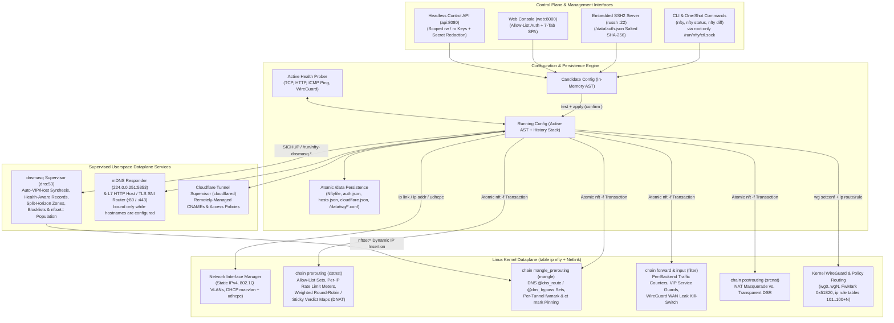

# `nfty` Documentation

`nfty` is a Linux L4/L7 service load balancer, virtual IP (VIP) appliance, programmable DNS endpoint, and policy-routing egress gateway (direct Internet NAT or multi-tunnel WireGuard) written in Rust.

It compiles a declarative configuration file (`/data/Nftyfile`), an interactive hierarchical CLI, or a 1:1 HTTP/JSON Control API into atomic kernel `nftables` rulesets (`table ip nfty`). It runs either as a standalone daemon on existing Linux hosts or directly as `/sbin/init` (PID 1) inside an LXD system container, UEFI unikernel VM, or bare-metal ARM64 / Rockchip RK3588S appliance.

---

## Documentation Index

| Document | Contents |
| :--- | :--- |
| [1. Getting Started & Deployment Guide](./getting-started.md) | Building from source (`glibc` and static `musl`), deployment modes (Standalone Daemon, LXD Container, Bootable Unikernel VM, Bare-Metal ARM64/RK3588S), initial VIP bootstrap, SSH setup, and CLI usage. |
| [2. `Nftyfile` Configuration Reference](./nftyfile-reference.md) | Declarative syntax reference for `/data/Nftyfile`: global `allow` ACLs, static/VLAN/DHCP `macvlan` `vip` blocks, L4/L7 `service` blocks, `gateway` blocks, `dns` blocks, and `no ...` negation rules. |
| [3. Interactive CLI Guide](./interactive-cli-and-tui.md) | Operational vs. Configuration modes, hierarchical drill-down contexts, Candidate vs. Running state workflows, rollback timers (`apply confirm <secs>`), and troubleshooting (`debug`). |
| [4. REST API & Web Console Reference](./api-reference.md) | Configuring `web:<port>` (interactive Web Console with IP allow-list auth) and `api:<port>` (headless JSON API with `ro`/`rw` keys), key redaction behavior, and HTTP endpoint schemas. |
| [5. Programmable DNS, WireGuard Gateways & Cloudflare Tunnels](./dns-and-wireguard-gateways.md) | `dnsmasq` supervision, health-aware DNS, split-horizon zones, `nftset` domain policy routing (`route`/`bypass`), multi-tunnel WireGuard ECMP gateways, inbound port forwards, and Cloudflare Tunnels. |
| [6. `web:<port>` Web Console Specification](./web-interface-spec.md) | Architecture and view reference for the embedded 7-tab single-page Web Console, allow-list authentication, and Web CLI drawer. |

---

## Architecture Overview

`nfty` separates candidate and running configuration from kernel and userspace dataplanes. `test` can dry-run the generated `nftables` rules; applying a configuration spans additional subsystems and is not one atomic transaction.

---

## Subsystems Summary

| Capability | Subsystem | Implementation Details |
| :--- | :--- | :--- |
| **Virtual IP (VIP) Management** | `compiler.rs` / `unikernel.rs` | Static IPv4 VIPs (`192.168.10.10/24`), 802.1Q VLAN sub-interfaces (`vlan 20`), and named DHCP `macvlan` VIPs (`vip sonarr { dhcp eth0 }`) with deterministic MAC addresses and `udhcpc` hostname registration. |
| **Kernel L4 Load Balancing** | `table ip nfty` (`prerouting`) | TCP, UDP, or dual-stack (`both`) port forwarding; weighted `round-robin` (`numgen inc mod N`) or source-IP `sticky` (`ip saddr mod N`) verdict maps; `nat` (masquerade) or `transparent` (preserve client IP) modes; automatic `backup` backend failover. |
| **Active Health Checking** | `health.rs` | Periodic `tcp`, `http <path>`, and `ping` (ICMP) probes with latency tracking. Unhealthy or manually `drained` backends are removed from active kernel `nftables` maps and DNS responses without dropping existing flows. |
| **Allow-Lists & Rate Limiting** | `table ip nfty` (`allow_*`, `meter_*`) | Global and per-service/per-gateway ACLs supporting exact IPs, CIDRs (`10.0.0.0/8`), IP wildcards (`192.168.1.*`), hostnames (`admin.office.lan`), and wildcard hostnames (`*.office.lan`). Per-IP or global rate guards apply to first packets in the NAT chain, not every packet in an established flow. |
| **L7 Host/SNI Proxy & mDNS** | `features/vhost_mdns.rs` | Multiplexes ports `80` and `443` across multiple backend services on the same VIP by inspecting HTTP `Host` headers and TLS ClientHello `SNI` extensions. Includes an embedded multicast mDNS responder (`224.0.0.251:5353`). Both listeners bind only while a configured hostname needs them. |
| **Internet NAT & WireGuard Gateways** | `features/wireguard.rs` | Virtual Gateway IPs (`gateway 192.168.10.20`) usable as a LAN default gateway. Operates in Direct Internet NAT mode or WireGuard Multi-Tunnel ECMP mode with per-tunnel `fwmark` routing tables, `ct mark` connection pinning, WAN leak `killswitch`, and inbound port forwarding (`forward <port> to <ip:port>`). |
| **Programmable DNS (`dnsmasq` + `nftset`)** | `features/dns.rs` | `dnsmasq` supervisor with automatic VIP/host `A` and `PTR` synthesis, health-aware record filtering, authoritative `a`/`aaaa`/`address`/`cname`/`txt`/`srv`/`mx`/`ptr` records, conditional split-horizon `forward` zones (optionally pinned `via <gateway>`), domain blocklists, and `nftset` domain routing (`route <domain> via <gw>`, `bypass <domain> from <gw>`). |
| **Cloudflare Tunnels** | `features/cloudflare.rs` | `cloudflare-dns <fqdn>` provisions Cloudflare Tunnels, ingress rules, and proxied CNAME records. `cloudflare-auth` supports Access email/domain policies and fails closed (`403`) until the policy is verified. |
| **Web Console & Control API** | `api.rs` | `web:<port>` serves the embedded 7-tab Web Console (`GET /`) with IP allow-list authentication; `api:<port>` serves the headless JSON API (`/api/v1/*`) with `rw` and `ro` scoped API keys and automatic secret redaction (`<redacted-rw-key>`). |
| **PID-1 Unikernel & Container Runtime** | `unikernel.rs` / `ssh.rs` | Boots as `/sbin/init`, mounts `/proc`, `/sys`, `/dev`, and persistent `/data`, runs an embedded SSH2 server (`russh`) with first-login password rotation, and serves local CLI sessions over the root-only controller socket (`/run/nfty/ctl.sock`). |
