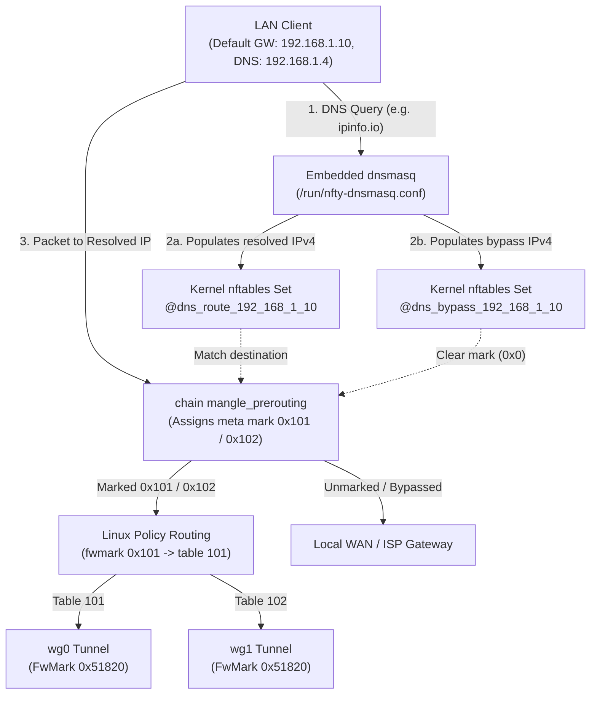

# Programmable DNS, WireGuard Gateways & Zero-Trust Tunnels

Beyond Layer 4 load balancing, `nfty` unifies **authoritative & split-horizon DNS (`dnsmasq`)**, **multi-tunnel WireGuard Virtual Gateways**, **DNS-driven kernel `nftset` policy routing**, and **Cloudflare Zero-Trust tunnels (`cloudflared`)** inside a single declarative `Nftyfile`.

---

## Table of Contents

1. [Architecture Overview](#1-architecture-overview)
2. [Programmable DNS (`dns` Block)](#2-programmable-dns-dns-block)
3. [Automatic VIP & Health-Aware Service DNS Discovery](#3-automatic-vip--health-aware-service-dns-discovery)
4. [Split-Horizon DNS & Tunnel-Bound Upstream Forwarding](#4-split-horizon-dns--tunnel-bound-upstream-forwarding)
5. [DNS-Driven Kernel `nftset` Policy Routing (`route` & `bypass`)](#5-dns-driven-kernel-nftset-policy-routing-route--bypass)
6. [Ad, Tracker & Malware Sinkholing (`block` & `blocklist`)](#6-ad-tracker--malware-sinkholing-block--blocklist)
7. [WireGuard Virtual Gateways (`gateway` Block)](#7-wireguard-virtual-gateways-gateway-block)
8. [WireGuard Ingress Endpoints (`wg-in:<port>`) & Client QR Code Generator](#8-wireguard-ingress-endpoints-wg-inport--client-qr-code-generator)
9. [Inbound Port Forwarding](#9-inbound-port-forwarding)
10. [Cloudflare DNS & Zero-Trust Tunnels (`cloudflare-dns` & `cloudflare-auth`)](#10-cloudflare-dns--zero-trust-tunnels-cloudflare-dns--cloudflare-auth)

---

## 1. Architecture Overview

The following diagram illustrates how `nfty` coordinates `dnsmasq`, kernel `nftables` sets (`@dns_route_<gw>` and `@dns_bypass_<gw>`), Linux policy routing tables (`101..100+N`), and `wg0..wgN` interfaces:



---

## 2. Programmable DNS (`dns` Block)

When a `dns { ... }` block is declared in `/data/Nftyfile`, `nfty` generates `/run/nfty-dnsmasq.conf` and `/run/nfty-dnsmasq.hosts` and supervises the system `dnsmasq` process. Whenever the configuration or backend health state changes, `nfty` rewrites the hosts file and sends `SIGHUP` to `dnsmasq` for zero-downtime reloads.

### Complete `dns` Block Example

```hcl
dns {
  # Bind addresses
  listen 192.168.1.4 10.20.0.1

  # Local authoritative search domain & cache tuning
  domain lan.internal
  cache-size 10000

  # Default upstream recursive resolvers
  upstream 1.1.1.1 1.0.0.1
  upstream 9.9.9.9

  # Automatic synthesis from nfty VIPs & services
  auto-vips on
  auto-hosts on
  health-aware on

  # Static authoritative DNS records
  a nas.lan.internal 192.168.1.50
  aaaa nas.lan.internal fd00:192:168::50
  cname files.lan.internal nas.lan.internal
  ptr 192.168.1.50 nas.lan.internal
  mx lan.internal mail.lan.internal 10
  txt lan.internal "v=spf1 mx -all"
  srv _ldap._tcp.lan.internal dc1.lan.internal:389 priority 10 weight 100

  # Split-horizon conditional forwarding
  forward corp.internal to 10.100.0.53
  forward vault.partner.net to 10.64.0.1 via 192.168.1.10

  # Dynamic nftset policy routing
  route ipinfo.io via 192.168.1.10
  route *.streaming.example.com via 192.168.1.10
  bypass *.local-bank.example.com from 192.168.1.10

  # Ad/tracker sinkholing (0.0.0.0 & ::)
  block telemetry.example.com
  block ads.example.net
  blocklist stevenblack /data/dns/lists/stevenblack-hosts.txt
}
```

### Authoritative Record Types

| Directive | Syntax | Description |
| :--- | :--- | :--- |
| `a` | `a <fqdn> <ipv4>` | Maps `<fqdn>` (and its short hostname if under `domain`) to `<ipv4>`. |
| `aaaa` | `aaaa <fqdn> <ipv6>` | Maps `<fqdn>` to `<ipv6>`. |
| `cname` | `cname <alias> <target>` | Creates a canonical name alias pointing `<alias>` to `<target>`. |
| `ptr` | `ptr <ip> <fqdn>` | Creates a reverse DNS `PTR` record for `<ip>`. |
| `mx` | `mx <domain> <mailhost> [prio]` | Creates an `MX` mail exchange record (default priority `10`). |
| `txt` | `txt <fqdn> "<text>"` | Publishes an arbitrary `TXT` record. |
| `srv` | `srv <_service._proto.domain> <target:port> [priority P] [weight W]` | Publishes an RFC 2782 `SRV` record for service discovery. |

---

## 3. Automatic VIP & Health-Aware Service DNS Discovery

`nfty` eliminates manual DNS bookkeeping by automatically synthesizing DNS records from your configured `vip`, `service`, and `gateway` blocks:

1. **`auto-vips on`** (default: `on`):
   - Automatically registers named VIPs, service `hostname`s, `cloudflare-dns` names, and gateway `hostname`s.
2. **`auto-hosts on`** (default: `on`):
   - Automatically registers host mappings from `/data/hosts.json` and resolved backend hostnames.
   - If a service declares `hostname grafana.corp.internal`, that FQDN is automatically registered as an `A` record pointing to the parent VIP.
3. **`health-aware on`** (default: `on`):
   - Ties DNS resolution directly to `nfty`'s real-time L4/L7 health prober.
   - If **all** primary and backup backends for `service grafana:3000` are `DOWN` (or `DRAINING`), `nfty` dynamically withdraws `grafana.lan.internal` from `/run/nfty-dnsmasq.hosts` and reloads `dnsmasq` so clients immediately fail over or receive `NXDOMAIN` instead of blackholing traffic. As soon as at least one backend passes health checks, the `A` record is restored.

---

## 4. Split-Horizon DNS & Tunnel-Bound Upstream Forwarding

With `forward <domain> to <nameserver> [via <gateway>]`, you can route DNS queries for specific internal or partner zones to dedicated upstream DNS servers:

```hcl
dns {
  # Standard split-horizon forwarding to an internal Active Directory / CoreDNS server
  forward k8s.internal to 10.96.0.10:53

  # Route DNS queries for a remote private zone through a WireGuard gateway
  forward internal.partner.org to 10.64.0.1 via 192.168.1.10
}
```

### How `via <gateway>` Works Under the Hood

When `via 192.168.1.10` is appended to a `forward` rule:
1. `nfty` looks up the primary tunnel interface IP (e.g., `10.64.0.2` on `wg0`) associated with `gateway 192.168.1.10`.
2. `nfty` emits `server=/internal.partner.org/10.64.0.1@10.64.0.2` in `/run/nfty-dnsmasq.conf` to bind outbound DNS queries to the WireGuard tunnel source IP.
3. In `table ip nfty -> chain mangle_output`, `nfty` adds a kernel rule matching `ip daddr 10.64.0.1 udp dport 53` and `tcp dport 53` that stamps `meta mark set 0x101`, ensuring the DNS query itself is policy-routed inside the encrypted WireGuard tunnel and never leaks onto the local WAN.

---

## 5. DNS-Driven Kernel `nftset` Policy Routing (`route` & `bypass`)

Traditional policy-based routing struggles with modern CDN-backed services whose IPv4 addresses change on every DNS lookup. `nfty` solves this by combining `dnsmasq`'s native `nftset=` directive with dynamic kernel `nftables` sets in `table ip nfty`:

```hcl
dns {
  # Force specific domains through WireGuard gateway 192.168.1.10
  route ipinfo.io via 192.168.1.10
  route github.com via 192.168.1.10

  # Exempt specific domains from a full-tunnel WireGuard gateway
  bypass local-stream.example.com from 192.168.1.10
}
```

### Step-by-Step Packet Flow

1. **Kernel Set Creation**: When `nfty` compiles `table ip nfty`, it creates two dynamic IPv4 sets with a 1-hour entry timeout (`timeout 1h`) for each gateway:
   ```nft
   set dns_route_192_168_1_10 {
       type ipv4_addr
       flags dynamic, timeout
       timeout 1h
   }
   set dns_bypass_192_168_1_10 {
       type ipv4_addr
       flags dynamic, timeout
       timeout 1h
   }
   ```
2. **Real-Time DNS Population**: When a client queries `ipinfo.io`, `dnsmasq` resolves the `A` records and immediately inserts the returned IPv4 addresses into `@dns_route_192_168_1_10` via netlink (`nftset=/ipinfo.io/4#ip#nfty#dns_route_192_168_1_10`) **before** returning the DNS reply to the client.
3. **Zero-Latency Kernel Forwarding**:
   - When the client sends its first TCP `SYN` or UDP packet to the resolved IP, `chain mangle_prerouting` matches `ip daddr @dns_route_192_168_1_10` and applies the gateway's WireGuard tunnel mark (`meta mark set 0x101` or ECMP `numgen inc mod N`).
   - Conversely, if a LAN client uses `192.168.1.10` as its full-tunnel default gateway, matching `ip daddr @dns_bypass_192_168_1_10` clears the packet mark (`meta mark set 0x0`) and skips the gateway's killswitch so traffic exits directly via the local WAN router.

---

## 6. Ad, Tracker & Malware Sinkholing (`block` & `blocklist`)

`nfty` can act as a network-wide DNS sinkhole (similar to Pi-hole or AdGuard Home) with zero additional software:

- **Inline Domain Blocking (`block <domain>`)**:
  Emits `address=/<domain>/0.0.0.0` and `address=/<domain>/::`, immediately returning `0.0.0.0` / `::` for `<domain>` and all of its subdomains.
- **External Blocklists (`blocklist <name> <path-or-url>`)**:
  Reference standard `/etc/hosts`-formatted lists or domain-per-line lists from a local path or HTTP(S) URL:
  ```hcl
  dns {
    block doubleclick.net
    blocklist ads /data/dns/lists/ads-hosts.txt
    blocklist malware /data/dns/lists/malware-domains.txt
  }
  ```
  - Lists are normalized and cached as hosts files, then loaded via `addn-hosts`; arbitrary dnsmasq configuration fragments are not supported as blocklists.
  - If a refresh fails, the last cached list is retained with a warning. A missing or empty list fails reconciliation rather than silently disabling blocking.

---

## 7. WireGuard Virtual Gateways (`gateway` Block)

A `gateway` block configures `nfty` as a policy-routed WireGuard router and load balancer. Any machine on the LAN can set its default gateway (or route specific subnets/domains) to the `gateway` IP (e.g., `192.168.1.10`) to have its traffic encrypted and load-balanced across one or more WireGuard tunnels.

### Managing WireGuard Profiles (`/data/wg/`)

You can supply WireGuard tunnel configurations in two ways:
1. **Saved `.conf` Files in `/data/wg/`**:
   Upload standard WireGuard client configurations (`[Interface]` + `[Peer]`) using the CLI (`wg add <name>`, then paste) or REST API (`POST /api/v1/wg`), and reference them inside `tunnels { ... }`:
   ```hcl
   gateway 192.168.1.10/24@eth0 {
     balance round-robin
     killswitch on
     tunnels {
       wg-mullvad-us1.conf weight 2
       wg-mullvad-us2.conf weight 1
     }
   }
   ```
2. **Inline Tunnel Declarations**:
   Define tunnels directly inside `Nftyfile`:
   ```hcl
   gateway 192.168.1.10/24@eth0 {
     balance sticky
     killswitch on
     tunnels {
       wg0 address 10.64.0.2/32 privkey YWFhYWFhYWFhYWFhYWFhYWFhYWFhYWFhYWFhYWFhYWE= peer YmJiYmJiYmJiYmJiYmJiYmJiYmJiYmJiYmJiYmJiYmI= endpoint 198.51.100.10:51820 weight 2
     }
   }
   ```

### Multi-Tunnel Kernel Routing & Loop Prevention (`FwMark`)

File-based tunnels get deterministic interface names derived from the gateway
and profile; explicit inline `wgN` names remain unchanged. Automatically
assigned interface names from earlier versions may change after upgrade.

When `nfty` brings up WireGuard tunnels:
1. **Outer UDP Loop Prevention (`FwMark = 0x51820`)**:
   Every WireGuard interface is configured with `FwMark = 0x51820`, distinct from the per-tunnel policy-routing marks.
2. **Per-Tunnel Routing Tables**:
   Each interface gets a routing table and mark derived from its interface index. Low indices retain the legacy `101 + i` table and `0x101 + i` mark; larger indices use a separate range to avoid built-in routing tables. Policy rules use priority `1000`.
3. **Kernel ECMP Load Balancing (`round-robin` vs `sticky`)**:
   - `balance round-robin` (default): Distributes new flows across eligible tunnels by weight and stores the selected mark in conntrack.
   - `balance sticky`: Uses a hash of the source and destination addresses to select a tunnel.
4. **Killswitch (`killswitch on|off`)**:
   When enabled, the generated rules drop new gateway traffic if no tunnel is eligible, and drop marked external traffic that would leave through a non-WireGuard interface. This is not a substitute for validating the complete network topology and recovery behavior on the deployment.

---

## 8. WireGuard Ingress Endpoints (`wg-in:<port>`) & Client QR Code Generator

In addition to outbound egress tunnels (`tunnels { ... }`), any `gateway` block can expose an **inbound WireGuard VPN server** via `wg-in:<port>` (default UDP port `51820`).

`nfty` provisions a dedicated kernel WireGuard ingress interface (`ig0`, `ig1`, ...) distinct from outbound `wg*` interfaces, automatically binds `dnsmasq` to the tunnel gateway IP (e.g. `10.99.0.1`), and compiles `nftables` forwarding, NAT, and `fwmark` chaining rules.

### Split-Tunnel LAN Access vs. Full-Tunnel Exit Chaining

1. **Split-Tunnel LAN Mode (`split-tunnel lan` or `split-tunnel <cidr...>`)**:
   - Client configurations receive `AllowedIPs = 10.99.0.0/24, <gateway-lan-cidr>` (or your custom CIDRs).
   - Remote laptops and phones reach internal LAN hosts, VIPs, and private DNS through `ig0` (masqueraded onto `eth0` / `mv-*`) while keeping their local internet connection for general web traffic.
2. **Full-Tunnel Exit Mode (`split-tunnel full`, default)**:
   - Client configurations receive `AllowedIPs = 0.0.0.0/0`.
   - If the gateway is a **Direct Internet Gateway** (no `tunnels` block), remote client traffic exits via `nfty`'s WAN interface (`eth0`).
   - If the gateway has **outbound WireGuard `tunnels { ... }`**, `chain mangle_prerouting` marks non-LAN traffic arriving on `ig0` with the gateway's outbound tunnel `fwmark`, seamlessly chaining remote VPN clients (`ig0`) out through the encrypted upstream WireGuard tunnel pool (`wg0..wgN`) while still allowing direct access to local LAN subnets.

### Declarative `Nftyfile` Example

```hcl
gateway 169.254.10.20/24 {
  dns:53
  killswitch on
  wg-in:51820 {
    subnet 10.99.0.1/24
    endpoint vpn.example.com:51820
    dns 10.99.0.1
    split-tunnel full
    peer phone 10.99.0.2/32 pubkey YmJiYmJiYmJiYmJiYmJiYmJiYmJiYmJiYmJiYmJiYmI= psk ZGRkZGRkZGRkZGRkZGRkZGRkZGRkZGRkZGRkZGRkZGQ=
    peer laptop 10.99.0.3/32 pubkey Y2NjY2NjY2NjY2NjY2NjY2NjY2NjY2NjY2NjY2NjY2M=
  }
  tunnels {
    wg-exit-01.conf
  }
}
```

### Interactive Client Provisioning & Terminal QR Code Output

`nfty` supports both **appliance-generated client keypairs** (persisted in `/data/wg-peers/<gw>/<name>.json` with `0600` permissions so you can re-display the `.conf` or QR code at any time) and **user-supplied client public keys** (zero-trust mode where the client's private key never touches the appliance):

```text
nfty> configure
nfty(config)# gateway 169.254.10.20
nfty(config-gateway:169.254.10.20)# wg-in:51820
nfty(config-gateway:169.254.10.20-wg:51820)# subnet 10.99.0.1/24
nfty(config-gateway:169.254.10.20-wg:51820)# endpoint vpn.example.com:51820
nfty(config-gateway:169.254.10.20-wg:51820)# split-tunnel full
nfty(config-gateway:169.254.10.20-wg:51820)# peer add phone
  ✔ Added WireGuard ingress peer 'phone' (10.99.0.2/32) on gateway 169.254.10.20:51820
    ( prints copy/paste [Interface]/[Peer] .conf and UTF-8 half-block QR code )
nfty(config-gateway:169.254.10.20-wg:51820)# peer add laptop pubkey Y2NjY2NjY2NjY2NjY2NjY2NjY2NjY2NjY2NjY2NjY2M=
nfty(config-gateway:169.254.10.20-wg:51820)# apply
```

From operational mode (`nfty>`), you can inspect or re-render any peer's configuration or QR code at any time:

```text
nfty> peer list
nfty> peer show phone
nfty> peer qr phone
```

---

## 9. Inbound Port Forwarding

Gateways can forward inbound ports from the remote WireGuard VPN exit into a LAN host:

```hcl
gateway 192.168.1.10/24@eth0 {
  balance round-robin
  killswitch on

  forward 51413 to 192.168.20.15:51413
  forward 6881/udp to 192.168.20.15:6881

  tunnels {
    wg-mullvad-us1.conf
  }
}
```
### Symmetric Inbound Port Forwarding (`forward <port> to <ip:port>`)

When `forward 51413 to 192.168.20.15:51413` is configured on a gateway:
1. **Inbound DNAT**: Packets arriving from `iifname "wg0"` on port `51413` are marked in `chain mangle_prerouting` (`ct mark set 0x101`) and DNATed in `chain prerouting` to `192.168.20.15:51413`.
2. **Masquerade**: `chain postrouting` masquerades the forwarded packet to the `nfty` appliance's LAN address so `192.168.20.15` always sends replies back to `nfty` regardless of its own default gateway.
3. **Symmetric Tunnel Return**: When `192.168.20.15` replies, `chain mangle_prerouting` restores `meta mark set ct mark` (`0x101`), ensuring return packets are routed back out the exact same WireGuard tunnel (`wg0`) they entered on.

### Native Privoxy-Compatible HTTP/HTTPS Forward Proxy (`proxy:8118`)

Both `gateway` and `vip` blocks support `proxy:8118` (or `proxy:<port>`), which binds `nfty`'s built-in Rust HTTP/HTTPS (`CONNECT`) forward proxy to that IP:
- **Gateway Tunnel Routing & Killswitch**: On a `gateway` with WireGuard `tunnels { ... }`, outbound TCP sockets and UDP DNS `A`-record queries are bound to the selected healthy tunnel (`SO_MARK` + `SO_BINDTODEVICE`). If `killswitch on` is set and all tunnels are down, the proxy refuses outbound connections (`502 Bad Gateway — Gateway killswitch active`).
- **Privacy Header Sanitization & Adblock Enforcement**: Strips `Proxy-Connection`, `Proxy-Authorization`, `X-Forwarded-For`, `X-Real-IP`, `Client-IP`, `From`, and `Via`, enforces `dns { block ... }` domain blocklists (`403 Forbidden`), and blocks SSRF to loopback, link-local, or appliance-owned VIP/Gateway IPs.

---

## 10. Cloudflare DNS & Zero-Trust Tunnels (`cloudflare-dns` & `cloudflare-auth`)

`nfty` integrates directly with the Cloudflare v4 API and supervises `cloudflared` to expose internal services externally with optional edge authentication:

```hcl
vip 192.168.1.4/24@eth0 {
  service grafana:3000 {
    hostname grafana.example.com

    # Automatically provision/update a proxied Cloudflare DNS record
    cloudflare-dns grafana.example.com

    # Expose through a supervised Cloudflare Zero-Trust Tunnel (cloudflared)
    cloudflare-auth ops@example.com

    to 192.168.1.21:3000
  }
}
```

### Setting Up Cloudflare Credentials

Configure your Cloudflare API Token and Account ID (or pre-generated Tunnel Token) via the CLI or REST API:

```text
nfty> cf token cf_api_token_here 0123456789abcdef0123456789abcdef
Saved Cloudflare API token and Account ID to /data/cloudflare.json.
nfty> cf sync
Reconciled Cloudflare Zero-Trust tunnel and DNS records.
nfty> cf status
```

### Authentication

Email and domain rules in `cloudflare-auth` require a successfully reconciled
Cloudflare Access policy. If it cannot be verified, the connector is stopped
instead of substituting an appliance-password policy. Until the policy is
verified, the tunnel ingress for that hostname returns `403`. Existing unmanaged
Access applications or extra policies are not modified automatically. `nfty`
does not provide local HTTP authentication; restrict local access with `allow`.

Cloudflare reconciliation runs asynchronously. Its lock and generation
tracking are process-local, so separate sessions can race with the controller;
remote changes and local dataplane updates are not one transaction. Verify
the connector and Access policies after configuration changes.
