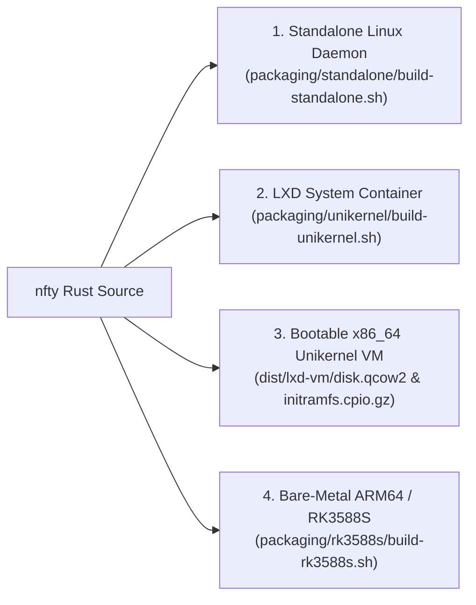

# Getting Started & Deployment Guide

This guide covers building **`nfty`** from source, deploying it across all four supported runtime architectures, bootstrapping your first Virtual IP (VIP), completing the first-boot SSH security workflow, and using the zero-flag appliance CLI.

---

## 1. Prerequisites & Building from Source

### Host Build Requirements

- **Operating System**: Linux (`x86_64` or `aarch64`), Kernel 5.10+ with `nf_tables` enabled.
- **Rust Toolchain**: Rust `1.75+` (`cargo`, `rustup`).
- **Static Musl Target** (for LXD appliance containers and bootable unikernel images):
  ```bash
  rustup target add x86_64-unknown-linux-musl
  ```
- **ARM64 Cross-Compilation Target** (for Rockchip RK3588S / ARM64 SBC builds):
  ```bash
  rustup target add aarch64-unknown-linux-musl
  ```

### Runtime Dependencies (Target Host or Bundled Appliance Rootfs)

When running as a standalone daemon on an existing Linux server, ensure the following binaries are installed (all of these are automatically bundled into the appliance rootfs when using the unikernel/LXD/RK3588S packaging scripts):

| Binary | Package | Required For |
| :--- | :--- | :--- |
| `nft` | `nftables` | Compiling and applying atomic `table ip nfty` kernel rulesets |
| `ip` | `iproute2` | Binding static VIPs, 802.1Q VLANs, `macvlan` devices, and WireGuard policy routing tables |
| `wg` | `wireguard-tools` | Configuring WireGuard interfaces (`wg0`..`wgN`) for `gateway` blocks |
| `dnsmasq` | `dnsmasq` (with `nftset`) | Programmable DNS server (`dns:53` / `dns { ... }`) and dynamic `@dns_route` / `@dns_bypass` sets |
| `busybox` | `busybox-static` | `udhcpc` DHCP client leases, `arping` Gratuitous ARP, `ping` probes, and PID-1 `mount`/`modprobe` |
| `cloudflared` | `cloudflared` (optional) | Remotely-managed Cloudflare Zero-Trust Tunnels (`cloudflare-dns`) |

### Standard Release Build (`glibc`)

```bash
git clone https://github.com/your-org/nfty.git
cd nfty
cargo build --release
```

The optimized binary is written to `target/release/nfty`.

### Fully Static Build (`musl`)

To produce a zero-dependency static binary suitable for minimal containers or initramfs environments:

```bash
cargo build --release --target x86_64-unknown-linux-musl
strip target/x86_64-unknown-linux-musl/release/nfty
```

---

## 2. Deployment Modes

`nfty` supports four production deployment targets from the same codebase:



### Mode 1: Standalone Linux Daemon (`systemd`)

Use this mode to run `nfty` on an existing Debian, Ubuntu, Arch, Fedora, or Alpine Linux router/server.

1. **Build the standalone distribution archive**:
   ```bash
   ./packaging/standalone/build-standalone.sh
   ```
   This produces:
   - `dist/standalone/nfty` (stripped release binary)
   - `dist/standalone/nfty.service` (systemd unit file)
   - `dist/standalone/Nftyfile` (blank starter configuration)
   - `dist/nfty-standalone-linux-x86_64.tar.gz`

2. **Install the binary, configuration directory, and systemd service**:
   ```bash
   sudo install -m 0755 dist/standalone/nfty /usr/local/bin/nfty
   sudo mkdir -p /etc/nfty /data/wg
   sudo touch /etc/nfty/Nftyfile
   sudo cp dist/standalone/nfty.service /etc/systemd/system/nfty.service
   sudo systemctl daemon-reload
   sudo systemctl enable --now nfty.service
   ```

3. **Inspect the systemd unit (`/etc/systemd/system/nfty.service`)**:
   ```ini
   [Unit]
   Description=nfty — Caddy-style L4 Service Load Balancer & Port Router for nftables
   After=network-online.target nftables.service
   Wants=network-online.target

   [Service]
   Type=simple
   ExecStart=/usr/local/bin/nfty --file /etc/nfty/Nftyfile --api-bind 127.0.0.1:9090 daemon
   ExecReload=/bin/kill -HUP $MAINPID
   Restart=always
   RestartSec=2
   AmbientCapabilities=CAP_NET_ADMIN CAP_NET_RAW CAP_NET_BIND_SERVICE

   [Install]
   WantedBy=multi-user.target
   ```

4. **Run manually in foreground daemon mode**:
   ```bash
   sudo nfty --file /etc/nfty/Nftyfile --api-bind 127.0.0.1:9090 daemon
   ```

---

### Mode 2: LXD System Container Appliance (PID-1 = `/bin/nfty`)

In LXD container mode, `nfty` is compiled as a static `musl` binary and symlinked to `/sbin/init`, `/bin/sh`, `/bin/bash`, and `/bin/udhcpc-hook` inside a minimal ~15 MiB rootfs. When the container starts, `nfty` boots directly as **PID 1**, brings up networking, mounts `/data`, starts the embedded SSH server (`russh`) on port 22, and applies `/data/Nftyfile`. Because `/bin/sh` is symlinked to `/bin/nfty`, running `lxc exec nfty -- sh` or `lxc console nfty` drops you straight into the `nfty>` router prompt.

#### Building and Launching Locally on LXD

```bash
# 1. Build the static musl binary and LXD container/VM images into dist/
./packaging/unikernel/build-unikernel.sh

# 2. Import the container image into LXD
lxc image import dist/lxd-container/lxd.tar.gz dist/lxd-container/rootfs.tar.gz --alias nfty-ct

# 3. Create a persistent storage volume for /data so state survives container rebuilds
lxc storage volume create default nfty-data

# 4. Initialize the container and attach the persistent /data volume
lxc init nfty-ct nfty
lxc config device add nfty data disk pool=default source=nfty-data path=/data

# 5. Start the appliance
lxc start nfty
```

#### Automated Remote Deployment & Zero-Downtime Upgrades (`deploy-lxd.sh`)

To build the latest LXD container image and roll it out to a remote LXD host while preserving `/data` (`Nftyfile`, `auth.json`, `hosts.json`, `cloudflare.json`, and `/data/wg/*.conf`) and the container's MAC/IP address:

```bash
./packaging/deploy-lxd.sh <lxd-host-ip> [instance-name]

# Example deploying to LXD host 169.254.1.3:
./packaging/deploy-lxd.sh 169.254.1.3 nfty
```

`packaging/deploy-lxd.sh` automatically:
1. Runs `./packaging/unikernel/build-unikernel.sh`.
2. Uploads `dist/lxd-container/lxd.tar.gz` and `rootfs.tar.gz` to the LXD host.
3. Ensures the persistent LXD storage volume (`default/<instance>-data`) exists and migrates any existing `/data` files into it if not already attached.
4. Executes `lxc rebuild nfty-ct-staging <instance> --force`, replacing the rootfs while keeping `/data` intact.

---

### Mode 3: Bootable Unikernel / QEMU-KVM / Bare-Metal x86_64

`packaging/unikernel/build-unikernel.sh` builds a hybrid BIOS + UEFI Secure Boot ISO (`dist/nfty-unikernel-x86_64.iso`), a standalone initramfs (`dist/nfty-unikernel-initramfs.cpio.gz`), and a 264 MiB bootable UEFI Secure Boot GPT disk image (`dist/nfty-unikernel-x86_64.img.gz` / `dist/lxd-vm/disk.qcow2`):

- **Partition 1 (128 MiB FAT32 ESP)**: Microsoft UEFI CA signed `shim-signed` (`BOOTX64.EFI`), `grub-efi-amd64-signed` (`grubx64.efi`), signed Debian 6.12 LTS Linux kernel (`vmlinuz`), and `initramfs.img` (`rdinit=/init`).
- **Partition 2 (128 MiB `ext4`, label `nfty-data`)**: Automatically mounted at `/data` by `nfty` when booting as PID 1 and pre-seeded with `gateway default { dhcp eth0; ssh:22 }`.

#### Launching as an LXD Virtual Machine

```bash
./packaging/unikernel/build-unikernel.sh
lxc image import dist/lxd-vm/lxd.tar.gz dist/lxd-vm/disk.qcow2 --alias nfty-unikernel
lxc launch nfty-unikernel nfty-vm --vm
lxc console nfty-vm
```

#### Launching Directly with QEMU/KVM

You can boot the hybrid BIOS + UEFI Secure Boot ISO or the qcow2 disk image directly with QEMU/KVM:

```bash
qemu-system-x86_64 \
  -enable-kvm \
  -m 512M \
  -smp 2 \
  -cdrom dist/nfty-unikernel-x86_64.iso \
  -netdev user,id=net0,hostfwd=tcp::2222-:22,hostfwd=tcp::9090-:9090 \
  -device virtio-net-pci,netdev=net0 \
  -nographic
```

Or boot kernel + initramfs directly without a disk image:

```bash
qemu-system-x86_64 \
  -enable-kvm -m 256M -smp 2 \
  -kernel /boot/vmlinuz-linux \
  -initrd dist/nfty-unikernel-initramfs.cpio.gz \
  -append "console=ttyS0 quiet rdinit=/init -- --unikernel --file /data/Nftyfile --api-bind 0.0.0.0:9090" \
  -nographic
```

---

### Mode 4: Bare-Metal ARM64 / Rockchip RK3588S SBCs

`packaging/rk3588s/build-rk3588s.sh` cross-compiles `nfty` to `aarch64-unknown-linux-musl` and assembles a complete bare-metal ARM64 appliance image (`dist/rk3588s/nfty-rk3588s.img.gz`) as well as an ARM64 LXD container image (`dist/lxd-container-arm64/`).

#### Supported RK3588S / RK3588 Boards

| Board Argument | Target Hardware | Device Tree (`.dtb`) |
| :--- | :--- | :--- |
| `generic` (default) | Universal RK3588S / RK3588 (Auto-DTB via U-Boot `fdtfile`) | All mainline `rk3588*.dtb` included in `/dtbs/rockchip/` |
| `orangepi-5` | Xunlong Orange Pi 5 | `rk3588s-orangepi-5.dtb` |
| `orangepi-5b` | Xunlong Orange Pi 5B | `rk3588s-orangepi-5b.dtb` |
| `rock-5a` | Radxa ROCK 5A | `rk3588s-rock-5a.dtb` |
| `rock-5c` | Radxa ROCK 5C | `rk3588s-rock-5c.dtb` |
| `nanopi-r6s` | FriendlyElec NanoPi R6S (Dual 2.5GbE + 1GbE router SBC) | `rk3588s-nanopi-r6s.dtb` |
| `nanopi-r6c` | FriendlyElec NanoPi R6C | `rk3588s-nanopi-r6c.dtb` |
| `edge2` / `khadas-edge2` | Khadas Edge2 | `rk3588s-khadas-edge2.dtb` |
| `odroid-m2` | Hardkernel ODROID-M2 | `rk3588s-odroid-m2.dtb` |

#### Building and Flashing the RK3588S Image

```bash
# Build universal RK3588S image (U-Boot + UEFI hybrid boot + Linux 6.18 LTS + ARM64 initramfs)
./packaging/rk3588s/build-rk3588s.sh

# Or build with board-specific default DTB & edk2-rk3588 UEFI firmware:
./packaging/rk3588s/build-rk3588s.sh nanopi-r6s

# Flash to MicroSD card, eMMC module, or NVMe drive (/dev/sdX or /dev/mmcblkX):
zcat dist/rk3588s/nfty-rk3588s.img.gz | sudo dd of=/dev/sdX bs=4M status=progress conv=fsync
```

When the RK3588S board powers on:
1. Rockchip U-Boot (`idbloader.img` at sector 64, `u-boot.itb` at sector 16384) or `edk2-rk3588` UEFI loads Linux 6.18 LTS and `nfty-rk3588s-initramfs.cpio.gz`.
2. `nfty` boots as PID 1 (`/init`), loads kernel modules (`nf_tables`, `wireguard`, `8021q`, `macvlan`, `r8169`, `stmmac`, `nvme`), and mounts Partition 2 (`LABEL=nfty-data`) at `/data`.
3. `eth0` automatically acquires an IPv4 lease via `udhcpc`, and the console shell starts on serial UART (`ttyS2` / `ttyFIQ0` at `1500000` baud) and HDMI (`tty0`).

---

## 3. First-Boot Default DHCP Gateway & SSH Login

### Default Out-of-the-Box Gateway (`gateway default`)

Every fresh unikernel and container appliance ships with a pre-seeded `/data/Nftyfile` defining a DHCP gateway named `default` with SSH (`ssh:22`) enabled:

```hcl
gateway default {
    dhcp eth0
    ssh:22
}
```

When the appliance boots, `nfty` automatically creates the `mv-default` `macvlan` interface on `eth0`, acquires a DHCP lease (advertising hostname `default`), applies the kernel `nftables` ruleset, and exposes SSH on port 22 so you can always connect right away:

```bash
ssh nfty@default
# or connect to the leased IP shown in `show gateways` / `show interfaces`
```

### Step 1 (Optional): Bootstrap a Static Virtual IP

If you prefer a static Virtual IP instead of the default DHCP gateway, the `bootstrap` command binds a static Virtual IP to `eth0`, creates an initial `vip` block with local SSH (`ssh:22`) enabled and rate-limited (`30/min burst 10 per-ip`), applies the `nftables` ruleset to the kernel, and persists `/data/Nftyfile`.

From an LXD host:

```bash
lxc exec nfty -- nfty -c "bootstrap 169.254.10.10/24 dev eth0"
```

Or from the serial/VM console (`lxc console nfty`):

```text
nfty> bootstrap 169.254.10.10/24 dev eth0
  ✔ Bootstrapped VIP 169.254.10.10/24 on eth0 (created base config 'service 169.254.10.10:22' with SSH enabled)
  → ip addr replace 169.254.10.10/24 dev eth0
```

This creates `/data/Nftyfile`:

```hcl
vip 169.254.10.10/24 {
    ssh:22 {
        check tcp 5s
        limit 30/min burst 10 per-ip
    }
}
```

> **Note:** By default, `nfty` blocks port 22 on any configured VIP unless `ssh:22` (or `ssh`) is explicitly listed inside that `vip { ... }` or `gateway { ... }` block.

### Step 2: Connect via SSH & Complete First-Login Password Rotation

Connect to the bootstrapped VIP using any standard SSH client:

```bash
ssh nfty@169.254.10.10
```

- **Default Username**: `nfty`
- **Default Initial Password**: `nfty`
- **Host Key Persistence**: On first boot, `nfty` generates an Ed25519 SSH host key and stores it at `/data/ssh_host_ed25519_key` (`0600` permissions) so SSH clients never see host-key warnings across reboots or container rebuilds.

Upon logging in for the first time while the default password (`nfty`) is still active, `nfty` enforces an interactive password change before granting access to the shell:

```text
==================================================================
 ⚠ FIRST LOGIN SECURITY NOTICE: Default password ('nfty') active!
 You must set a new password for user 'nfty' before continuing.
==================================================================

New password for 'nfty': ************
Confirm new password: ************
  ✔ Password for 'nfty' updated and saved!

Welcome to nfty — Caddy-style L4 Service Load Balancer & Port Router for nftables
1:1 Control API listening on http://0.0.0.0:9090 (endpoints: /api/v1/allow, /api/v1/cli, /api/v1/status)
Type configure to enter config mode, status for live status, watch for live TUI, or ? for help.

nfty>
```

#### How `/data/auth.json` Persists Credentials

Credentials are stored in `/data/auth.json` with `0600` permissions using a salted SHA-256 digest (`nfty-salt-v1:`):

```json
{
  "username": "nfty",
  "password_sha256": "a94c8fe5ccb19ba61c4c0873d391e987982fbbd3...",
  "must_change_password": false
}
```

You can rotate the appliance password at any time from the interactive CLI by running `password` (or `passwd`), and you can reuse the `nfty` credential for HTTP Basic Auth on services by specifying `auth nfty`.

---

## 4. Zero-Flag Appliance Ergonomics & One-Shot CLI Usage

`nfty` is designed for zero-flag ergonomics on routers and appliances:

1. **Automatic Config Path Resolution**:
   When invoked without `--file`, `nfty` automatically locates your configuration file in the following order:
   - `/data/Nftyfile` (Appliance / Unikernel / LXD persistent volume)
   - `./Nftyfile` (Current working directory)
   - `/etc/nfty/Nftyfile` (Standalone Linux daemon path)
2. **Automatic Daemon IPC Sync**:
   When you run `nfty` from a secondary SSH session or `lxc exec` shell (where `PID != 1`), any configuration changes you apply are atomically written to `/data/Nftyfile` **and** pushed over loopback IPC (`127.0.0.1:9090`) to the running daemon so background health checkers, `dnsmasq`, and proxy supervisors update immediately.

### Common CLI Invocations

| Command | Description |
| :--- | :--- |
| `nfty` (or `nfty shell`) | Starts the interactive hierarchical router shell (`nfty>`) and connects to/spawns background health checks and API listeners. |
| `nfty status` | Refreshes DNS allow-lists, runs an immediate health probe pass across all backends and WireGuard tunnels, and prints the colorized service/gateway status table. |
| `nfty diff` | Compares the candidate configuration with the active running configuration and prints a colorized unified diff. |
| `nfty reload` (or `nfty apply`) | Reconciles VIPs/VLANs/DHCP interfaces, compiles `Nftyfile`, applies it atomically to kernel `nftables`, and persists state to `/data`. |
| `nfty watch` | Opens the live interactive `ratatui` terminal dashboard (TUI) with real-time packet/byte counters, latency, and live `nftables` verdict map inspection. |
| `nfty validate` | Validates `Nftyfile` syntax and runs a kernel `nft -c -f -` dry-run check (exits `0` on success, `1` on error). |
| `nfty compile` | Compiles `Nftyfile` and prints the complete generated `#!/usr/sbin/nft -f` ruleset (`table ip nfty`) to `stdout`. |
| `nfty daemon` | Runs headless in the foreground (applies config, runs active health probes, supervises `dnsmasq` / `cloudflared` / proxies, and serves the HTTP API). |
| `nfty "<commands>"` (or `nfty -c "<commands>"`) | Executes semicolon-separated CLI commands non-interactively and exits. |

### One-Shot Non-Interactive Scripting (`-c` / `--command`)

You can execute any sequence of operational or configuration commands in a single non-interactive invocation by separating commands with `;`:

```bash
# Provision a static VIP, forward port 80 to 10.0.1.50:8080 with TCP health checks, and commit:
nfty -c "vip 10.0.1.10/24; 80 to 10.0.1.50:8080; check tcp 5s; apply"

# Inspect candidate vs. running diff from a script:
nfty -c "diff"

# Drain a backend node before maintenance:
nfty -c "drain 10.0.1.50:8080"

# Re-enable the backend node after maintenance:
nfty -c "enable 10.0.1.50:8080"
```

---

## Next Steps

- Learn the complete `/data/Nftyfile` syntax in the **[`Nftyfile` Configuration Reference](./nftyfile-reference.md)**.
- Explore the interactive shell, `scan`/`adopt`, and safe rollback timers in the **[Interactive CLI & Live TUI Guide](./interactive-cli-and-tui.md)**.
