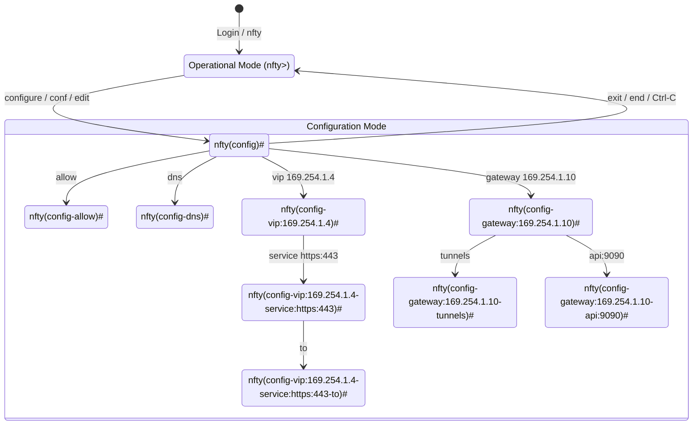
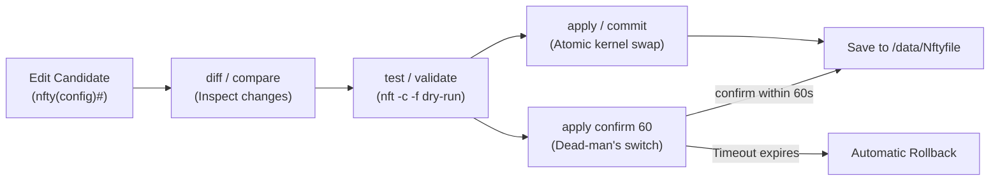

# Interactive CLI & Live TUI Guide

`nfty` includes an embedded Cisco IOS / Juniper Junos-inspired hierarchical command-line interface (CLI) and a real-time terminal user interface (TUI). You can access the CLI over the embedded SSH server (`:22` on unikernel/container appliances or `:2222` on standalone hosts), via the local UNIX control socket (`/run/nfty.sock`), or through one-shot commands.

---

## Table of Contents

1. [Zero-Flag CLI & One-Shot Execution](#1-zero-flag-cli--one-shot-execution)
2. [Operational Mode vs. Configuration Mode](#2-operational-mode-vs-configuration-mode)
3. [Hierarchy Navigation & Input Shortcuts](#3-hierarchy-navigation--input-shortcuts)
4. [Configuration Context Drill-Down](#4-configuration-context-drill-down)
5. [Candidate vs. Running Configuration Workflow](#5-candidate-vs-running-configuration-workflow)
6. [Operational Mode Commands](#6-operational-mode-commands)
7. [Live Interactive TUI (`watch`)](#7-live-interactive-tui-watch)

---

## 1. Zero-Flag CLI & One-Shot Execution

When running `nfty` directly on a Linux host or inside an appliance container, the binary uses an ergonomic zero-flag design that communicates with the running daemon over `/run/nfty.sock`:

| Command | Description |
| :--- | :--- |
| `nfty` | Connects to the running daemon's interactive CLI (`nfty>`) over `/run/nfty.sock`. If the daemon is not yet running, automatically initializes and starts it. |
| `nfty status` | Prints the current VIP, service, backend health, WireGuard gateway, and DNS status table and exits. |
| `nfty diff` | Compares the candidate configuration with the active running configuration and prints a colorized unified diff. |
| `nfty reload` | Re-parses `/data/Nftyfile`, compiles it into an atomic `nft -f` batch transaction, and reloads the kernel dataplane. |
| `nfty watch` | Launches the full-screen interactive real-time TUI monitor (`250ms` refresh cycle). |
| `nfty daemon` | Runs the background supervisor, health prober, SSH server, and REST API server in the foreground (used by `systemd` or PID 1). |
| `nfty "<cli command>"` | Executes any CLI command sequence (supporting `;` command chaining) against the daemon and prints the output to stdout. |
| `nfty -c "<cli command>"` | Explicit flag alias for executing a one-shot CLI command sequence. |

### One-Shot Scripting Examples

```bash
# Check overall appliance status
nfty status

# Inspect active NAT conntrack flows matching port 443
nfty "flows 443"

# Drain a backend server before maintenance
nfty "drain 169.254.1.21:443"

# Add a new backend to an existing service and commit atomically
nfty "configure; vip 169.254.1.4; service https:443; to 169.254.1.23:443 weight 2; apply; save"

# Execute a remote one-shot command over SSH
ssh admin@169.254.1.4 "show nft"
```

---

## 2. Operational Mode vs. Configuration Mode

The interactive shell separates **Operational Mode** (read-only inspection, health probing, draining, flow viewing, and LAN scanning) from **Configuration Mode** (editing the in-memory candidate AST, diffing, testing, and committing).



### Prompt Indicators Reference

The shell prompt dynamically reflects your exact location in the configuration hierarchy:

| Prompt | Context Level | Description |
| :--- | :--- | :--- |
| `nfty>` | Operational Mode | Default starting mode for status, flows, scanning, and runtime operations. |
| `nfty(config)#` | Root Configuration | Top-level candidate configuration context. |
| `nfty(config-allow)#` | Global Allowlist | Editing global `allow` subnets, hosts, and VLANs. |
| `nfty(config-dns)#` | Programmable DNS | Editing DNS listeners, zones, records, `nftset` routes, and blocklists. |
| `nfty(config-vip:<ip>)#` | Virtual IP Block | Editing a specific VIP (`169.254.1.4`, `169.254.1.4/24@eth0.20`, etc.). |
| `nfty(config-vip:<ip>-service)#` | VIP Services List | Intermediate context listing or selecting services inside a VIP. |
| `nfty(config-vip:<ip>-api:<port>)#` | VIP API Server | Managing scoped `rw` / `ro` API keys for a VIP-bound HTTP control plane. |
| `nfty(config-vip:<ip>-service:<key>)#` | VIP Service | Editing a specific service (`https:443`, `dns:53/udp`) inside a VIP. |
| `nfty(config-vip:<ip>-service:<key>-to)#` | Service Backends | Adding/removing backend targets (`ip:port [weight W] [backup]`). |
| `nfty(config-vip:<ip>-service:<key>-allow)#` | Service ACL | Editing per-service source IP/CIDR/hostname allowlists. |
| `nfty(config-service:<key>)#` | Standalone Service | Editing a top-level service block (not nested inside a VIP). |
| `nfty(config-gateway:<ip>)#` | WireGuard Gateway | Editing a virtual gateway router (`gateway 169.254.1.10`). |
| `nfty(config-gateway:<ip>-tunnels)#` | Gateway Tunnels | Adding/removing WireGuard `.conf` profile references or inline tunnels. |
| `nfty(config-gateway:<ip>-service)#` | Gateway Services | Managing services nested under a WireGuard gateway. |
| `nfty(config-gateway:<ip>-api:<port>)#` | Gateway API Server | Managing scoped `rw` / `ro` API keys bound to the gateway IP. |

---

## 3. Hierarchy Navigation & Input Shortcuts

`nfty` supports fast navigation across hierarchy levels as well as multi-command chaining and raw block pasting:

| Command / Shortcut | Action |
| :--- | :--- |
| `configure` / `conf` / `edit` | Enter `nfty(config)#` from `nfty>`. |
| `..` or `up` | Move up one level in the configuration hierarchy (e.g., from `service` back to `vip`). |
| `top` | Jump directly from any nested sub-context back to `nfty(config)#`. |
| `exit` or `end` | From a nested sub-context, step up one level; from `nfty(config)#`, return to `nfty>`; from `nfty>`, close the session. |
| `Ctrl-C` | Abort the current input line and immediately return to `nfty>` (or exit if already at `nfty>`). |
| `;` (Semicolon) | Chain multiple commands on a single line (e.g., `vip 169.254.1.4; service web:80; to 169.254.1.20:8080; top`). |
| `?` or `help` | Display context-sensitive help for the current hierarchy level. |
| `Tab` | Auto-complete commands, sub-contexts, service names, and parameters. |

### Pasting Multi-Line `Nftyfile` Blocks

When at `nfty(config)#`, you can paste raw `Nftyfile` blocks containing `{` and `}` braces directly into the terminal. The REPL automatically detects brace depth (`paste_buf`) and parses the entire block into the candidate configuration once the closing `}` is reached:

```text
nfty(config)# vip 169.254.1.4/24 {
  service app:8443 {
    balance round-robin
    check tcp 2s
    to {
      169.254.1.31:8443 weight 2
      169.254.1.32:8443 weight 1
    }
  }
}
Parsed and merged into candidate configuration.
```

---

## 4. Configuration Context Drill-Down

Instead of writing braces, you can interactively drill down into any configuration object or issue full inline paths from `nfty(config)#`.

### Drilling into VIPs, Services, Backends, and Allowlists

```text
nfty> configure
Entering configuration mode. Type 'apply' to commit, 'exit' to leave.
nfty(config)# allow
nfty(config-allow)# 169.254.1.0/24
Added '169.254.1.0/24' to global allow list.
nfty(config-allow)# 10.100.0.0/16
Added '10.100.0.0/16' to global allow list.
nfty(config-allow)# ..
nfty(config)# vip 169.254.1.4/24@eth0
nfty(config-vip:169.254.1.4)# api:9090
nfty(config-vip:169.254.1.4-api:9090)# key new rw
Generated new rw API key on vip 169.254.1.4 api:9090:
  nfty_rw_84f9a2d1c3e5b7091a2b3c4d5e6f7a8b
nfty(config-vip:169.254.1.4-api:9090)# key new ro
Generated new ro API key on vip 169.254.1.4 api:9090:
  nfty_ro_19c4e8b2a0f6d3157e8a9b0c1d2e3f4a
nfty(config-vip:169.254.1.4-api:9090)# ..
nfty(config-vip:169.254.1.4)# service https:443
nfty(config-vip:169.254.1.4-service:https:443)# balance sticky 30m
Set balance to sticky 30m.
nfty(config-vip:169.254.1.4-service:https:443)# mode dnat
Set forwarding mode to dnat.
nfty(config-vip:169.254.1.4-service:https:443)# check https 5s /healthz host app.internal
Set health check to https every 5s.
nfty(config-vip:169.254.1.4-service:https:443)# to
nfty(config-vip:169.254.1.4-service:https:443-to)# 169.254.1.21:443 weight 3
Added backend 169.254.1.21:443.
nfty(config-vip:169.254.1.4-service:https:443-to)# 169.254.1.22:443 weight 1
Added backend 169.254.1.22:443.
nfty(config-vip:169.254.1.4-service:https:443-to)# 169.254.1.99:443 backup
Added backup backend 169.254.1.99:443.
nfty(config-vip:169.254.1.4-service:https:443-to)# top
nfty(config)#
```

### Drilling into WireGuard Gateways and DNS

```text
nfty(config)# gateway 169.254.1.10/24@eth0
nfty(config-gateway:169.254.1.10)# balance round-robin
nfty(config-gateway:169.254.1.10)# killswitch on
nfty(config-gateway:169.254.1.10)# privoxy:8118
nfty(config-gateway:169.254.1.10)# socks5:1080
nfty(config-gateway:169.254.1.10)# forward 51413 to 169.254.20.15:51413
nfty(config-gateway:169.254.1.10)# tunnels
nfty(config-gateway:169.254.1.10-tunnels)# wg-mullvad-us1.conf weight 2
nfty(config-gateway:169.254.1.10-tunnels)# wg-mullvad-us2.conf weight 1
nfty(config-gateway:169.254.1.10-tunnels)# top
nfty(config)# dns
nfty(config-dns)# listen 169.254.1.4:53
nfty(config-dns)# domain lan.internal
nfty(config-dns)# upstream 1.1.1.1 9.9.9.9
nfty(config-dns)# route ipinfo.io via 169.254.1.10
nfty(config-dns)# bypass bank.com from 169.254.1.10
nfty(config-dns)# top
```

### Removing Items with `no ...`

Every context supports negating directives using the `no` prefix (see the [Nftyfile Configuration Reference](./nftyfile-reference.md#9-removing-configuration-with-no-) for the complete matrix):

```text
nfty(config)# vip 169.254.1.4
nfty(config-vip:169.254.1.4)# service https:443
nfty(config-vip:169.254.1.4-service:https:443)# no to 169.254.1.22:443
Removed backend 169.254.1.22:443.
nfty(config-vip:169.254.1.4-service:https:443)# no check
Reverted health check to default (tcp 3s).
```

---

## 5. Candidate vs. Running Configuration Workflow

`nfty` uses a two-stage transactional configuration model:
1. **Running Configuration**: The active configuration currently compiled into the Linux kernel's `table ip nfty` / `table netdev nfty_ingress` ruleset and actively monitored by health probers.
2. **Candidate Configuration**: Your staging buffer in `nfty(config)#`. Modifications made in `configure` mode only affect the candidate configuration until you explicitly `apply` (or `commit`) them.



### Configuration Lifecycle Commands

| Command | Aliases | Description |
| :--- | :--- | :--- |
| `show` | `show [section]` | Displays the configuration for the current context (or specific section: `all`, `running`, `candidate`, `nft`, `allow`, `vips`, `dns`). |
| `diff` | `compare` | Shows a colorized line-by-line diff (`-` removed in red, `+` added in green) between the running config and candidate config. |
| `test` | `validate` | Compiles the candidate config into `nftables` batch commands and runs `nft -c -f -` (kernel dry-run validation) without applying changes. |
| `apply` | `commit` | Compiles and atomically applies the candidate config to the kernel, snapshots the previous running config to the rollback ring, and saves to `/data/Nftyfile`. |
| `apply confirm [sec]` | `commit confirmed [sec]` | Applies the candidate config tentatively with an automatic rollback timer (default `60` seconds). If you do not run `confirm` before the timer expires, `nfty` automatically reverts to the previous running config. |
| `confirm` | — | Cancels an active `apply confirm` rollback countdown and persists the configuration to `/data/Nftyfile`. |
| `discard` | `load` | Discards all uncommitted edits in the candidate configuration and reloads it from the active running configuration. |
| `rollback [N]` | — | Reverts the running configuration to snapshot `N` (default `1`, up to the last 10 applied configurations in the rollback ring). |
| `save [path]` | `write` | Writes the configuration to `/data/Nftyfile` (or a custom file path). |

> [!TIP]
> **Preventing Remote Lockout with `apply confirm`**
> When modifying `allow` rules, VLAN tags, or WireGuard `killswitch` settings over a remote SSH session, use `apply confirm 30`. If the change drops your SSH connection, `nfty` automatically restores the previous configuration after 30 seconds.

---

## 6. Operational Mode Commands

The following commands are available at `nfty>` (and from `nfty(config)#` when not shadowed by a sub-context):

### Health, Backends & Probing

| Command | Description |
| :--- | :--- |
| `status` | Displays a comprehensive dashboard of all VIPs, services, backend health states (`UP`, `DOWN`, `DRAINING`, `STANDBY`), RTT latencies, active failover state, WireGuard tunnels, and DNS status. |
| `probe` | Triggers an immediate out-of-band health probe across all services and backends and prints the refreshed status table. |
| `drain <ip:port>` | Marks a backend as `DRAINING` across all services referencing `<ip:port>` and immediately rebuilds the kernel `nftables` numgen verdict map to stop new connections while existing `conntrack` sessions finish gracefully. |
| `undrain <ip:port>` / `enable <ip:port>` | Clears the `DRAINING` state on `<ip:port>`, returning it to active rotation (if healthy) and immediately updating the kernel verdict map. |

### Flow Inspection & LAN Discovery

| Command | Description |
| :--- | :--- |
| `flows [filter]` / `conntrack [filter]` | Reads `/proc/net/nf_conntrack` and displays active NAT sessions (`proto`, `state`, `src -> dst`, `backend`, `packets`, `bytes`), optionally filtered by substring (IP, port, or protocol). |
| `scan [subnet\|host]` | Performs a fast asynchronous TCP port scan (`22, 53, 80, 443, 3000, 5000, 6443, 8000, 8080, 8443, 9000, 9090` + configured backend ports) across local `/24` subnets or a specified CIDR/host, with ARP MAC lookup and reverse DNS. |
| `adopt <idx\|name\|all> [vip <ip>] [port <p>] [vlan <id>]` | Automatically creates a load-balanced `service` in the candidate configuration from a host discovered via `scan`. |
| `host <hostname> <ip...>` | Adds or updates a static hostname mapping in `/etc/hosts` and refreshes hostname-based allowlists. |

#### Example: Scanning and Adopting a Discovered LAN Host

```text
nfty> scan 169.254.1.0/24
Scanning 254 hosts across 12 ports...
  #  IP Address      MAC Address        Hostname       Open Ports
  1  169.254.1.21    00:16:3e:a1:b2:c3  k8s-worker-01  22/ssh, 80/http, 443/https, 6443/k8s-api
  2  169.254.1.22    00:16:3e:a1:b2:c4  k8s-worker-02  22/ssh, 80/http, 443/https, 6443/k8s-api

nfty> adopt 1 vip 169.254.1.4
Adopted 169.254.1.21 into candidate config under vip 169.254.1.4.
Run 'configure; diff; apply' to activate.
```

### WireGuard Profile Management (`wg`)

| Command | Description |
| :--- | :--- |
| `wg` | Lists all WireGuard `.conf` profiles stored in `/data/wg/`, active `wg0..wgN` interfaces, endpoints, latest handshakes, and transfer counters. |
| `wg add <name>` / `wg paste <name>` | Enters interactive multi-line paste mode to upload a WireGuard `.conf` profile into `/data/wg/<name>.conf` (finish with `EOF` or an empty line). |
| `wg vi <name>` / `wg edit <name>` | Opens the built-in terminal editor for `/data/wg/<name>.conf`. |
| `wg show <name>` | Displays the contents of `/data/wg/<name>.conf` (with private keys visible to authenticated CLI administrators). |
| `wg rm <name>` | Deletes `/data/wg/<name>.conf` from disk. |

### Programmable DNS Operations (`dns`)

| Command | Description |
| :--- | :--- |
| `dns` / `dns status` | Shows the running `dnsmasq` daemon status, listening interfaces, auto-discovered VIP/service host count, active blocklists, and `nftset` policy routes. |
| `dns test <domain>` | Resolves `<domain>` against the local DNS server and displays the returned records and latency. |
| `dns config` | Displays the generated `/run/nfty-dnsmasq.conf` and `/run/nfty-dnsmasq.hosts` files. |
| `dns reload` | Regenerates the `dnsmasq` configuration and sends `SIGHUP` to reload records and blocklists with zero downtime. |

### Cloudflare Zero-Trust Operations (`cf` / `cloudflare`)

| Command | Description |
| :--- | :--- |
| `cf` / `cf status` | Displays Cloudflare API token state, `cloudflared` tunnel daemon status, and configured `cloudflare-dns` / `cloudflare-auth` services. |
| `cf token <API_TOKEN> [ACCOUNT_ID]` | Stores a Cloudflare API token (and optional Account ID for automatic Zero-Trust tunnel provisioning) in `/data/cloudflare.env` (`0600`). |
| `cf tunnel-token <TUNNEL_TOKEN>` | Stores a pre-generated `cloudflared` tunnel connector token (`eyJ...`) in `/data/cloudflare.env`. |
| `cf sync` | Immediately synchronizes all `cloudflare-dns` records and `cloudflare-auth` Zero-Trust ingress rules with the Cloudflare API. |
| `cf logs` | Displays the recent output ring buffer from the supervised `cloudflared` daemon. |
| `cf stop` | Stops the supervised `cloudflared` tunnel process. |
| `cf clear` | Removes stored Cloudflare credentials from `/data/cloudflare.env`. |

### Appliance Administration

| Command | Description |
| :--- | :--- |
| `password` | Interactively changes the SSH `admin` login password (persisted as a salted hash in `/data/ssh/passwd`). |
| `bootstrap` | Generates a starter `/data/Nftyfile` template by inspecting the host's primary interface and IP address. |

---

## 7. Live Interactive TUI (`watch`)

Running `watch` inside the CLI (or `nfty watch` directly from your shell) launches a full-screen `crossterm`-powered terminal dashboard that refreshes every `250ms`.

```text
┌──────────────────────────────────────────────────────────────────────────────┐
│ nfty v0.4.0 — Kernel-Native L4 Load Balancer               Uptime: 14d 06:22 │
│ VIPs: 2 | Services: 4 | Backends: 7 UP / 1 DRAIN / 0 DOWN | Active Flows: 84 │
├──────────────────────────────────────────────────────────────────────────────┤
│   VIP / Service         Mode   Balance       Backend            State    RTT │
│ ▸ 169.254.1.4/24@eth0   dnat   sticky 30m    169.254.1.21:443   UP     0.8ms │
│   └─ https:443          dnat   sticky 30m    169.254.1.22:443   DRAIN  1.1ms │
│   └─ https:443          dnat   sticky 30m    169.254.1.99:443   STDBY  0.9ms │
│   169.254.1.4/24@eth0   dnat   round-robin   169.254.1.31:53    UP     0.4ms │
│   └─ dns:53/udp         dnat   round-robin   169.254.1.32:53    UP     0.5ms │
├──────────────────────────────────────────────────────────────────────────────┤
│ Kernel nftables Verdict Map Preview (Press 'n' to toggle)                    │
│   ip daddr 169.254.1.4 tcp dport 443 dnat to numgen inc mod 3 map {          │
│     0 : 169.254.1.21 . 443, 1 : 169.254.1.21 . 443, 2 : 169.254.1.21 . 443   │
│   }                                                                          │
├──────────────────────────────────────────────────────────────────────────────┤
│ [↑/↓ or j/k] Select  [d] Drain  [e] Enable  [p] Probe  [n] Toggle NFT  [q] Quit│
└──────────────────────────────────────────────────────────────────────────────┘
```

### TUI Keyboard Shortcuts

| Key | Action |
| :--- | :--- |
| `↑` / `↓` or `k` / `j` | Move the selection cursor (`▸`) up or down through the list of backends. |
| `d` | Immediately **drain** the currently highlighted backend (`DRAINING`), removing it from the kernel `nftables` verdict map for new connections. |
| `e` | Immediately **enable / undrain** the currently highlighted backend (`UP`), restoring it to the kernel `nftables` verdict map. |
| `p` | Trigger an immediate out-of-band health probe across all backends and refresh RTT latencies. |
| `n` | Toggle the bottom **Kernel `nftables` Verdict Map Preview** pane on or off. |
| `q` or `Esc` | Exit the live TUI and return to the `nfty>` prompt (or shell). |
