# `web:<port>` — Interactive Web UI & Control Plane Specification

> **Status**: Implemented  
> **Target Binary**: `nfty` (Zero-dependency embedded SPA served directly by the static `musl` binary)  
> **Directive Syntax**: `web:<port>` (or `web` defaulting to `:8000`) inside `vip <ip|name> { ... }` and `gateway <ip|name> { ... }`

---

## 1. Overview & Goals

`nfty` provides strict separation between two local HTTP control-plane directives:
- **`web:<port>`** (default `:8000`): Serves the interactive single-page JavaScript Web Console (`GET /`, `/ui`, `/dashboard`, `/index.html`) **and** its backing `/api/v1/*` JSON endpoints on the same port, typically secured via an IP/CIDR/hostname `allow` list (e.g., `allow 192.168.0.0/16`).
- **`api:<port>`** (default `:9090`): Serves **only** the headless `/api/v1/*` JSON Control API (`GET /` returns `404 Not Found` JSON), secured via scoped `ro` / `rw` API keys.

Key capabilities:
1. **First-Class `Nftyfile` & REPL Directive (`web:<port>`)**:
   - Declare `web:8000` (or `web`) inside any `vip` or `gateway` block, with `allow`, `limit`, `auth`, `hostname` (mDNS `.local`), `cloudflare-dns`, and optional `key` sub-directives.
   - Kernel `nftables` `prerouting` and `input` chains automatically enforce any attached `allow` CIDR/hostname sets (`@allow_<id>`) and `limit` meters (`@meter_<id>`) before redirecting to the local `web:<port>` listener.
2. **Allow-List Authentication (plus Optional API Key / Appliance Login)**:
   - **IP Allow-List Auth (Primary for `web:<port>`)**: When `web:8000` is configured with an `allow` list (e.g., `allow 192.168.0.0/16`) and no API keys are required on that listener, clients matching the allow-list are permitted by both kernel `nftables` and userspace `authenticate_api_request_with_context` with full `rw` access.
   - **Appliance Login & Scoped API Keys**: Also supports logging in with the appliance username/password (`nfty` / `/data/auth.json` via `POST /api/v1/auth/login`) or switching to an `nfty_ro_...` / `nfty_rw_...` API key via the **🔑 Switch Key / Login** modal.
3. **Zero External Runtime Dependencies**:
   - Compiled directly into the static `nfty` binary (`WEB_CONSOLE_HTML` in `src/api.rs`) so it works offline inside the 10MB Unikernel, LXD container, and RK3588S bare-metal appliance with zero Node.js or external CDN requirements.

---

## 2. `Nftyfile` & Interactive CLI Syntax

### 2.1 `Nftyfile` Configuration Examples

#### Example A: Web Console on `192.168.1.4:8000` with IP Allow-List + Separate `api:8080`
```hcl
vip 192.168.1.4 {
    ssh:22
    web:8000 {
        allow {
            192.168.0.0/16
        }
    }
    api:8080 {
        key nfty_ro_5a2d949e15250c395c4b9683833c5bc3 ro
    }
    seer:5055 {
        hostname seer.local
        cloudflare-dns seer.smith.gr
        check tcp 5s
    }
}
```

#### Example B: Exposing `web:<port>` on a WireGuard Gateway with an Allow-List
```hcl
gateway 192.168.1.10 {
    balance round-robin
    killswitch on
    privoxy:8118
    web:8000
    allow {
        192.168.0.0/16
    }
    tunnels {
        ca-van-wg-201.conf
        ca-van-wg-202.conf
    }
}
```

### 2.2 Interactive REPL Drill-Down Workflow
```text
nfty> configure
nfty(config)# vip 192.168.1.4
nfty(config-vip:192.168.1.4)# web:8000
  ✔ [vip 192.168.1.4] + web:8000 (192.168.1.4:8000)
nfty(config-service:192.168.1.4:8000)# allow 192.168.0.0/16
  ✔ [service web:8000 (192.168.1.4:8000)] allow 192.168.0.0/16
nfty(config-service:192.168.1.4:8000)# apply
```

### 2.3 Strict Separation Between `web:<port>` and `api:<port>`
- Both `web:<port>` and `api:<port>` are bound dynamically by `spawn_api_server` in [src/api.rs](file:///home/gsmith/nfty/src/api.rs) and enforced in kernel `nftables` (`src/compiler.rs`).
- **`web:<port>`**: Serves the interactive JavaScript Web Console on `GET /` (`/ui`, `/dashboard`, `/index.html`) and `/api/v1/*` on the same port.
- **`api:<port>`**: Strictly a headless JSON Control API (`GET /` returns `404 Not Found` JSON; `/api/v1/*` requires a valid `ro` or `rw` API key).

---

## 3. Architecture & Data Flow

```mermaid
flowchart LR
    subgraph Browser["Browser Client (SPA on web:<port>)"]
        AuthGate["Auth & Scope Gate\n(API Key / Basic / Login)"]
        Store["Reactive State Store\n(2s Poll + Optimistic Actions)"]
        Views["8 Interactive Views\n+ Web CLI Drawer + Diff Bar"]
    end

    subgraph NftyDaemon["nfty Daemon (src/api.rs + Kernel)"]
        NftInput["Kernel nftables 'input' chain\nVIP IP + Allow-List + Rate Limit"]
        HttpRouter["HTTP/JSON Router (src/api.rs)\nStatic SPA Assets + /api/v1/*"]
        AuthCheck["Scope Verifier\nro vs rw + Secret Redaction"]
        AppState["SharedState\n(running vs candidate Config)"]
        Subsystems["Subsystems\nnftables | dnsmasq | wg | cloudflared | scanner"]
    end

    Browser -->|"HTTP GET / or /api/v1/*"| NftInput
    NftInput --> HttpRouter
    HttpRouter --> AuthCheck
    AuthCheck --> AppState
    AppState --> Subsystems
```



---

## 4. Frontend Application Architecture (Vanilla ES2022 Modules, Zero Build Step)

To keep the binary self-contained, fast, and dependency-free while providing a modern app experience:
- **Tech Stack**: Modern Vanilla JavaScript (ES2022+) with a clean reactive state store, URL hash router (`#/overview`, `#/vips`, `#/gateways`, `#/dns`, `#/firewall`, `#/flows`, `#/scanner`, `#/config`), and CSS custom-property dark theme.
- **Asset Delivery**:
  - `GET /` or `GET /index.html` → Main SPA shell + CSS + embedded JS modules.
  - Supports `?key=<token>` on initial URL load: automatically extracts the key, saves it in `sessionStorage` / `localStorage`, strips `?key=` from the address bar via `history.replaceState` (so keys aren't leaked in screenshots/shoulder-surfing), and attaches `Authorization: Bearer <key>` on all subsequent `fetch('/api/v1/...')` requests.

### 4.1 Authentication & Session UX
When a user visits `http://192.168.1.4:8080`:
1. **Auto-Probe**: The frontend calls `GET /api/v1/auth/whoami` (or `GET /api/v1/status`) with any stored token or `?key=` parameter.
2. **Login Modal (if `401 Unauthorized`)**:
   - **Tab 1 — API Key**: Paste an `nfty_ro_...` or `nfty_rw_...` token (with a "Remember in this browser" toggle).
   - **Tab 2 — Appliance Login**: Enter `username` (`nfty`) and `password` (verified against `/data/auth.json` via `POST /api/v1/auth/login`), granting `rw` scope.
3. **Scope Indicator Badge (Top Header)**:
   - Displays either:
     - `🟢 READ-WRITE (rw)` — All configuration editors, drain buttons, scanner adoption, and commit controls unlocked.
     - `🔵 READ-ONLY (ro)` — Live monitoring mode; displays an `"Unlock with RW Key"` button in the top bar.

---

## 5. Detailed View Specifications

### 5.1 Persistent Top Bar & Uncommitted Changes Banner
Across all tabs, the top bar displays:
- **Appliance Health Pill**: `KERNEL NFT APPLIED` (green) or `USERSPACE FALLBACK` (amber), live polling pulse (`2s`), and last-updated timestamp.
- **Pending Commit / Rollback Banner** (when `candidate != running` in `rw` mode):
  - Highlights the number of uncommitted changes.
  - Action buttons:
    - **`View Diff`** (opens side-by-side / unified diff modal of `running` vs `candidate` `Nftyfile` and compiled `nftables` ruleset)
    - **`Apply Now`** (`POST /api/v1/cli` → `apply`)
    - **`Commit Confirmed (60s)`** (`POST /api/v1/cli` → `commit confirmed 60`, showing a live countdown with a **`Confirm`** button to lock in changes)
    - **`Discard`** (`POST /api/v1/cli` → `discard`)
    - **`Rollback`** (`POST /api/v1/cli` → `rollback 1`)

---

### 5.2 Tab 1: Overview & Live Topology (`#/overview`)
- **KPI Summary Cards**:
  - **VIPs & Listeners**: Count of active VIPs (static + DHCP leased IPs + VLAN tags).
  - **L4/L7 Services**: Total services, healthy vs. degraded count.
  - **Backend Pool**: `UP` (green), `DOWN` (red), `DRAINED` (amber), with average probe latency (`ms`).
  - **WireGuard Gateways**: Active gateways, healthy ECMP tunnels (`wg0..wgN`), and aggregate tunnel throughput (`pps` / `bps`).
  - **DNS & Cloudflare**: `dnsmasq` status + `cloudflared` tunnel status & public hostnames.
- **Interactive Topology Map (SVG/Canvas)**:
  - Visualizes traffic flow from left to right:
    - **Column 1 (Ingress VIPs & Cloudflare)** → **Column 2 (Services & Virtual Hostnames / SNI)** → **Column 3 (Backends & WireGuard Tunnels)**
  - Live health color-coding on every node and animated dashed edges for active traffic (`pps > 0`).
- **Quick Probe Button**: Triggers `POST /api/v1/probe` and flashes updated latencies in real time.

---

### 5.3 Tab 2: VIPs & Services Manager (`#/vips`)
Grouped by **VIP Container** (`vip 192.168.1.4`, `vip sonarr`, etc.) plus standalone services:
- **VIP Card Header**:
  - Shows IP / DHCP status (`dhcp(eth0.20=192.168.20.50)`), interface/CIDR (`eth0/21`), VLAN tag, and enabled local control services (`ssh:22`, `dns:53`, `api:8080`, `web:8080`).
  - **`+ Add VIP`** / **`+ Add Service`** buttons (`rw` mode).
- **Service Rows & Backend Controls**:
  - Displays port/proto (`5055/tcp`), target (`seer:5055`), mDNS badge (`seer.local`), Cloudflare badge (`cf:seer.smith.gr 🔒`), balance strategy (`round-robin` / `sticky`), mode (`nat` / `transparent`), health check (`tcp 5s`, `http /healthz 5s`, `off`), rate limit, and allow-list tags.
  - **Per-Backend Action Buttons (`rw` mode)**:
    - **`Drain`** / **`Enable`** toggle (`POST /api/v1/backends/drain` & `/undrain`) — immediately removes/restores the backend in the kernel `nftables` verdict map with 1 click.
    - **`Edit Service`** modal (change port, backends, weights, backup flag, hostname, Cloudflare FQDN/Access policy, HTTP Basic Auth, health check, rate limit).
    - **`Delete Service`** (`DELETE /api/v1/services/<key>`).
- **API & Web Key Manager Drawer (`rw` mode)**:
  - For any `api:<port>` or `web:<port>` service, view existing keys, copy keys to clipboard, click **`+ Generate RO Key`** (`key new ro`) or **`+ Generate RW Key`** (`key new rw`), or revoke a key (`no key <token>`).

---

### 5.4 Tab 3: WireGuard Gateways & Tunnels (`#/gateways`)
- **Gateway Cards** (e.g., `gateway 192.168.1.10`):
  - Shows VIP interface (`eth0/21`), `balance` (`round-robin` / `sticky`), `killswitch` (`on` / `off` toggle in `rw` mode), attached gateway services (`privoxy:8118`, `socks5:1080`, `dns:53`, `ssh:22`, `web:8000`), and inbound port forwards (`forward 31743 to qbittorrent:31743`).
  - **ECMP Tunnel Table (`wg0`..`wgN`)**:
    - Shows profile name (`ca-van-wg-201.conf`), kernel interface (`wg0`), tunnel IP (`10.75.241.44/32`), peer endpoint (`104.193.135.196:51820`), probe health & latency (`UP 2.5ms`), weight, and live packet/byte counters.
    - Note: In `ro` mode, `private_key` and `preshared_key` are redacted (`<redacted>`) by the backend.
- **WireGuard `.conf` Profile Uploader (`rw` mode)**:
  - Drag-and-drop or paste `.conf` files (`POST /api/v1/wg`) and attach/detach them to any gateway (`tunnel <name>.conf` / `no tunnel <name>.conf`).
- **Port Forward Editor (`rw` mode)**:
  - Add/remove inbound tunnel port forwards (`forward <port[/tcp|/udp|/both]> to <backend:port>`).

---

### 5.5 Tab 4: Programmable DNS & Split-Horizon Routing (`#/dns`)
- **Global DNS Settings Panel**:
  - Toggles for `auto-vips`, `auto-hosts`, `health-aware`, `all-servers`, `bogus-priv`, `domain-needed`, local `domain` suffix (`lan` or `off`), `cache-size`, and upstream resolvers (`1.1.1.1`, `9.9.9.9`, or gateway-bound `@wg0`).
- **Authoritative Records Table**:
  - Filterable table of `A`, `AAAA`, `ADDRESS` (wildcard), `CNAME`, `TXT`, `SRV`, `MX`, and `PTR` records with **`+ Add Record`** and **`Delete`** actions in `rw` mode.
- **Dynamic `nftset` Policy Routing (`route` & `bypass`)**:
  - Visual editor for domain-based WireGuard routing (`route linuxisos.org via 192.168.1.10` → `@dns_route_...`) and VPN bypass rules (`bypass plex.tv netflix.com from 192.168.1.10` → `@dns_bypass_...`).
- **Ad/Tracker Sinkhole & Blocklists**:
  - Manage custom blocked domains (`block *.ads.example.com`) and remote hostlists (`blocklist oisd https://...`).

---

### 5.6 Tab 5: Firewall Allow-Lists & Cloudflare Zero-Trust (`#/firewall`)
- **Allow-List Manager (`GET/POST/DELETE /api/v1/allow`)**:
  - Manage Global `allow` and Per-Service `allow` rules (IPv4, CIDR, octet wildcards `192.168.1.*`, hostnames, and wildcard FQDNs `*.office.lan`).
  - Shows the live **Resolved Hostname Table** (`resolved_hosts`) and the **Expanded Kernel `nftables` Set Elements** (`expanded_service_sets`), plus a **`Refresh DNS Now`** button (`POST /api/v1/allow/refresh`).
- **Cloudflare Tunnel & Access Panel (`GET/POST /api/v1/cloudflare`)**:
  - Shows `cloudflared` daemon status/PID, tunnel ID/name, and all provisioned public hostnames (`seer.smith.gr` → `http://192.168.3.18:5055`, `gamble.smith.gr 🔒`).
  - In `rw` mode, configure Cloudflare API Token / Account ID / Tunnel name and edit per-service `cloudflare-dns`, `cloudflare-auth`, and HTTP Basic `auth` rules.

---

### 5.7 Tab 6: Live Conntrack Flow Inspector (`#/flows`)
- Real-time stream of `/proc/net/nf_conntrack` flows (`GET /api/v1/flows`):
  - **Instant Search & Filter Bar**: Filter by protocol (`tcp`/`udp`), state (`ESTABLISHED`, `SYN_SENT`), client source IP, VIP destination, NAT backend target, or WireGuard fwmark (`0x101`, `0x51820`).
  - **Pause / Resume Stream** toggle and auto-sort by highest bandwidth/packet count.

---

### 5.8 Tab 7: LAN / LXD Service Scanner & 1-Click Adopt (`#/scanner`) (`rw` only)
- **Scan Control Bar**:
  - Enter optional subnet/filter (or scan default local subnets) and click **`Scan Network`** (`POST /api/v1/scan`).
- **Discovered Services Table**:
  - Displays discovered IP, reverse hostname, open port, detected service name (`sonarr`, `plex`, `radarr`, `ssh`, `http`), banner, and probe latency.
  - **`1-Click Adopt` Button**: Opens a quick confirmation (or runs `adopt <index>`) to automatically create a DHCP/static VIP and service route for the discovered backend.

---

### 5.9 Tab 8: `Nftyfile` Code Editor, Live `nftables` Preview & Web CLI Drawer (`#/config`)
- **Split-Pane Code View**:
  - **Left Pane — `Nftyfile` Editor**:
    - Syntax-highlighted view of the active `Nftyfile` (with `<redacted-rw-key>` masked when viewed in `ro` mode, and full keys visible in `rw` mode).
    - In `rw` mode, editable with **`Validate & Stage`** / **`Apply Config (`PUT /api/v1/config`)`** buttons.
  - **Right Pane — Compiled Kernel `nftables` Ruleset**:
    - Live read-only view of `table ip nfty { ... }` (`GET /api/v1/nft`) with copy-to-clipboard button.
- **Slide-Up Web CLI Terminal Drawer (Keyboard Shortcut: `` ` `` or `Ctrl+J`, `rw` mode)**:
  - Interactive command prompt backed by `POST /api/v1/cli` supporting the exact same commands and drill-down syntax as SSH/REPL (`vip ...`, `service ...`, `status`, `diff`, `probe`, `wg`, `dns`).

---

## 6. Backend Implementation Plan (Rust Changes)

### 6.1 AST & Parser (`src/ast.rs`, `src/parser.rs`, `src/repl/*`)
1. **VIP Service (`Service`)**:
   - Add `pub fn is_local_web(&self) -> bool` in [`Service`](file:///home/gsmith/nfty/src/ast.rs#L431-L440) (checks `name` starting with `"web"` / `"web:"`).
   - Update `Service::display_name()` and `Service::format_in_vip()` so `web:<port>` formats and round-trips identically to `api:<port>` (including `key <token> ro|rw`, `hostname`, `allow`, `limit`, `cloudflare-dns`, `auth`).
   - In [`create_or_find_vip_service_by_key`](file:///home/gsmith/nfty/src/parser.rs#L1475-L1504), recognize `web` (default port `8080`) and `web:<port>` alongside `api` / `api:<port>`.
2. **Gateway Service (`GatewayServiceKind`)**:
   - Add `Web` variant to [`GatewayServiceKind`](file:///home/gsmith/nfty/src/ast.rs#L654-L660) (`privoxy`, `socks5`, `ssh`, `dns`, `api`, `web`).
   - Support `web:<port> { key new [ro|rw] }` inside `gateway` blocks and REPL drill-down.
3. **Config Helpers (`Config`)**:
   - Update `Config::api_ports()`, `Config::has_any_api_service()`, and `Config::verify_api_key()` so ports declared with either `api:<port>` or `web:<port>` are bound by the HTTP server and protected by the kernel `nftables` `input` chain.
   - Add `Config::web_ports(&self) -> Vec<u16>` so the HTTP server knows which ports have the full Web UI enabled.

### 6.2 Kernel `nftables` Input Chain (`src/compiler.rs`)
- Update `local_api_svcs` and `gw_api_svcs` in [`compile_nft_ruleset`](file:///home/gsmith/nfty/src/compiler.rs#L130-L165) to include `s.is_local_web()` and `GatewayServiceKind::Web`, generating the same VIP-scoped `tcp dport <port> accept` (plus `allow_<id>` and `meter_<id>`) rules before the drop rule.

### 6.3 HTTP Server & New Auth Endpoint (`src/api.rs`)
1. **`GET /api/v1/auth/whoami`**:
   - Returns `{"ok": true, "scope": "ro" | "rw", "authenticated": true}` when a valid key/session is provided, or `401` when authentication is required, allowing the SPA to immediately determine its capability level (`ro` vs `rw`).
2. **`POST /api/v1/auth/login`**:
   - Accepts `{"username": "nfty", "password": "..."}` and verifies against `crate::ssh::verify_login`. If valid, returns an ephemeral or configured `rw` token so operators can log into `web:<port>` using their SSH credentials even if they don't have an API key on their clipboard.
3. **Embedded SPA Bundle (`src/web_ui.rs` or `src/api.rs`)**:
   - Serve the full interactive SPA HTML/CSS/JS on `GET /` (and `/ui`, `/dashboard`, `/index.html`).

---

## 7. Verification & Test Plan

1. **AST & Parser Round-Trip Tests**:
   - Verify `vip 192.168.1.4 { web:8000 { allow { 192.168.0.0/16 } } }` parses, compiles to `nftables` `prerouting` set `@allow_192_168_1_4_8000`, and round-trips losslessly through `format_nftyfile()`.
   - Verify `Config::is_web_port(Some(8000)) == true` and `Config::is_web_port(Some(8080)) == false` so `api:<port>` never serves the HTML Web UI.
2. **Scope & Security Tests**:
   - Verify `GET /api/v1/auth/whoami` returns `scope: "ro"` for `ro` keys and `scope: "rw"` for `rw` keys.
   - Verify `ro` keys can load all read-only dashboard tabs (`/api/v1/status`, `/api/v1/config`, `/api/v1/flows`, `/api/v1/nft`, `/api/v1/wg`, `/api/v1/allow`) with `rw` keys and WireGuard private keys redacted, while any write action returns `403 Forbidden`.
   - Verify `rw` keys can execute backend drain/undrain, service edits, CLI commands, and config commits from the Web UI.
