# `web:<port>` — Web Console Architecture & Specification

- **Target Binary**: `nfty` (embedded single-page application served directly by the static binary)
- **Directive Syntax**: `web:<port>` (or `web`, defaulting to `:8000`) inside `vip <ip|name> { ... }` and `gateway <ip|name> { ... }`

---

## 1. Overview

`nfty` separates its two HTTP control-plane directives by port role:
- **`web:<port>`** (default `:8000`): Serves the interactive single-page JavaScript Web Console (`GET /`, `/ui`, `/dashboard`, `/index.html`) and its backing `/api/v1/*` JSON endpoints on the same port. It is typically secured via an IP/CIDR/hostname `allow` list (e.g., `allow 192.168.0.0/16`).
- **`api:<port>`** (default `:9090`): Serves only the headless `/api/v1/*` JSON Control API (`GET /` returns `404 Not Found` JSON), secured via scoped `ro` / `rw` API keys.

Core properties:
1. **Declarative `Nftyfile` and CLI Directive (`web:<port>`)**:
   - Declare `web:8000` (or `web`) inside any `vip` or `gateway` block, with `allow`, `limit`, `auth`, `hostname` (mDNS `.local`), `cloudflare-dns`, and optional `key` sub-directives.
   - Kernel `nftables` `prerouting` and `input` chains enforce any attached `allow` CIDR/hostname sets (`@allow_<id>`) and `limit` meters (`@meter_<id>`) before accepting traffic to the local `web:<port>` listener.
2. **Allow-List Authentication and Optional Token/Login Auth**:
   - **IP Allow-List Auth**: When `web:8000` is configured with an `allow` list (e.g., `allow 192.168.0.0/16`) and no API keys are required on that listener, clients matching the allow-list are permitted by both kernel `nftables` and userspace `authenticate_api_request_with_context` with `rw` access.
   - **Appliance Login & Scoped API Keys**: Operators can also authenticate using the appliance username/password (`nfty` / `/data/auth.json` via `POST /api/v1/auth/login`) or switch to an `nfty_ro_...` / `nfty_rw_...` API key via the **Switch Key / Login** modal.
3. **Self-Contained Static Assets**:
   - Compiled directly into the `nfty` binary (`WEB_CONSOLE_HTML` in `src/api.rs`) with no external runtime or CDN dependencies.

---

## 2. `Nftyfile` & Interactive CLI Syntax

### 2.1 `Nftyfile` Examples

#### Example A: Web Console on `192.168.1.4:8000` with IP Allow-List + Separate `api:8080`
```hcl
vip 192.168.1.4 {
    ssh:22
    web:8000 {
        allow {
            192.168.0.0/16
        }
    }
    api:8080 {
        key nfty_ro_5a2d949e15250c395c4b9683833c5bc3 ro
    }
    seer:5055 {
        hostname seer.local
        cloudflare-dns seer.smith.gr
        check tcp 5s
    }
}
```

#### Example B: Exposing `web:<port>` on a WireGuard Gateway with an Allow-List
```hcl
gateway 192.168.1.10 {
    balance round-robin
    killswitch on
    privoxy:8118
    web:8000
    allow {
        192.168.0.0/16
    }
    tunnels {
        ca-van-wg-201.conf
        ca-van-wg-202.conf
    }
}
```

### 2.2 Interactive CLI Workflow
```text
nfty> configure
nfty(config)# vip 192.168.1.4
nfty(config-vip:192.168.1.4)# web:8000
  [vip 192.168.1.4] + web:8000 (192.168.1.4:8000)
nfty(config-service:192.168.1.4:8000)# allow 192.168.0.0/16
  [service web:8000 (192.168.1.4:8000)] allow 192.168.0.0/16
nfty(config-service:192.168.1.4:8000)# apply
```

### 2.3 Port Separation Between `web:<port>` and `api:<port>`
- Both `web:<port>` and `api:<port>` are bound dynamically by `spawn_api_server` in `src/api.rs` and enforced in kernel `nftables` (`src/compiler.rs`).
- **`web:<port>`**: Serves the JavaScript Web Console on `GET /` (`/ui`, `/dashboard`, `/index.html`) and `/api/v1/*` on the same port.
- **`api:<port>`**: Serves only the JSON Control API (`GET /` returns `404 Not Found` JSON; `/api/v1/*` requires a valid `ro` or `rw` API key).

---

## 3. Architecture & Data Flow

```mermaid
flowchart LR
    subgraph Browser["Browser Client (SPA on web:<port>)"]
        AuthGate["Auth & Scope Gate\n(Allow-List / API Key / Login)"]
        Store["State Store\n(3s Poll + Action Dispatch)"]
        Views["8 Views\n+ Web CLI Drawer + Diff Bar"]
    end

    subgraph NftyDaemon["nfty Daemon (src/api.rs + Kernel)"]
        NftInput["Kernel nftables prerouting/input\nVIP IP + Allow-List + Rate Limit"]
        HttpRouter["HTTP/JSON Router (src/api.rs)\nStatic SPA + /api/v1/*"]
        AuthCheck["Scope Verifier\nAllow-List / ro / rw + Redaction"]
        AppState["SharedState\n(running vs candidate Config)"]
        Subsystems["Subsystems\nnftables | dnsmasq | wg | cloudflared | scanner"]
    end

    Browser -->|"HTTP GET / or /api/v1/*"| NftInput
    NftInput --> HttpRouter
    HttpRouter --> AuthCheck
    AuthCheck --> AppState
    AppState --> Subsystems
```



---

## 4. Frontend Structure

- **Implementation**: Vanilla JavaScript (ES2022+) embedded in `WEB_CONSOLE_HTML` in `src/api.rs`.
- **Asset Delivery**:
  - `GET /` (or `/ui`, `/dashboard`, `/index.html`) returns the HTML/CSS/JS bundle when `cfg.is_web_port(local_port)` is true.
  - Supports `?key=<token>` on initial URL load: extracts the key, stores it in `localStorage`, strips `?key=` from the address bar via `history.replaceState`, and attaches `Authorization: Bearer <key>` on subsequent `/api/v1/*` requests.

### 4.1 Authentication Flow
1. **Auto-Probe**: On load, the frontend queries `GET /api/v1/auth/whoami` and `GET /api/v1/status`. If the client IP matches the `web:<port>` `allow` list, authentication succeeds immediately with `scope: "rw"` and `mode: "allowlist"`.
2. **Login Modal (if `401 Unauthorized`)**:
   - **Tab 1 — API Key**: Enter an `nfty_ro_...` or `nfty_rw_...` token.
   - **Tab 2 — Appliance Login**: Enter `username` (`nfty`) and `password` (verified against `/data/auth.json` via `POST /api/v1/auth/login`), which issues an `rw` token.
3. **Scope Badge (Top Header)**:
   - `READ-WRITE (ALLOWLIST)` or `READ-WRITE (rw)` — All configuration editors, drain buttons, scanner adoption, and commit controls enabled.
   - `READ-ONLY (ro)` — Read-only monitoring mode with `rw` keys and WireGuard private keys redacted.

---

## 5. View Specifications

### 5.1 Top Bar & Uncommitted Changes Banner
- **Status Indicator**: Displays `KERNEL NFT ACTIVE` or `USERSPACE MODE`, scope badge, and refresh controls.
- **Uncommitted Changes Banner** (shown when `candidate != running` in `rw` mode):
  - **`Apply / Commit Now`** (`POST /api/v1/apply`)
  - **`Apply Confirm 60s`** (`POST /api/v1/cli` with `apply confirm 60`)
  - **`Discard`** (`POST /api/v1/cli` with `discard`)
  - **`Rollback`** (`POST /api/v1/cli` with `rollback 1`)

### 5.2 Tab 1: Overview & Topology
- **Summary Cards**: Active VIP count, L4/L7 services count, healthy/drained/down backend counts, WireGuard gateway/tunnel status, and active conntrack flow count.
- **VIP, Service, and Gateway Cards**: Displays each VIP and Gateway with its attached services, backends, health state (`UP`, `DOWN`, `DRAIN`), probe RTT (`ms`), and traffic counters.
- **Backend Health Matrix**: Tabular view of all backends with 1-click **`Drain`** / **`Enable`** actions (`rw` mode) and a **`Probe All`** button (`POST /api/v1/probe`).

### 5.3 Tab 2: VIPs & Services
- **Service Table & Creation (`rw` mode)**:
  - Add new services (`+ Add Service` modal supporting VIP, port/proto, backend `ip:port`, `balance`, `check`, `hostname`, `cloudflare-dns`, and `allow`).
  - Drain or enable individual backends (`POST /api/v1/backends/drain` and `/api/v1/backends/undrain`) or delete services (`DELETE /api/v1/services/<key>`).
- **API & Web Key Manager (`rw` mode)**:
  - Generate new `rw` or `ro` keys (`key new rw`, `key new ro`) or revoke keys on any `api:<port>` or `web:<port>` listener.

### 5.4 Tab 3: WireGuard Gateways
- **Gateway Status Cards**: Displays gateway IP/interface, `balance` mode, `killswitch` state, local proxy/service listeners (`privoxy:8118`, `socks5:1080`, `dns:53`, `ssh:22`, `web:8000`), inbound port forwards, and per-tunnel health/latency/traffic counters.
- **WireGuard `.conf` Uploader (`rw` mode)**: Upload `.conf` files (`POST /api/v1/wg`) into `/data/wg/` and inspect saved profiles (with `PrivateKey` redacted in `ro` mode).

### 5.5 Tab 4: Programmable DNS
- **DNS Settings & Quick Add (`rw` mode)**: Add `A`, `CNAME`, wildcard `address`, `route <domain> via <gw>`, `bypass <domain> from <gw>`, and `block <domain>` rules via `/api/v1/cli`.
- **Records & Policy Tables**: Displays configured authoritative records, `nftset` domain routing rules, split-horizon `forward` zones, and blocked domains.

### 5.6 Tab 5: Allow-Lists & Cloudflare
- **Allow-List Manager (`GET/POST/DELETE /api/v1/allow`)**: Manage global and per-service allow-lists, register dynamic `hostname -> IP` mappings (`POST /api/v1/allow/hosts`), trigger `POST /api/v1/allow/refresh`, and inspect expanded kernel `nftables` set elements.
- **Cloudflare Tunnel Panel (`GET/POST /api/v1/cloudflare`)**: View `cloudflared` tunnel status and configure Cloudflare API Token, Account ID, and Tunnel Name.

### 5.7 Tab 6: Conntrack Flows
- Real-time table of `/proc/net/nf_conntrack` entries (`GET /api/v1/flows`) with instant text filtering by protocol, state, source IP, destination VIP, or backend target.

### 5.8 Tab 7: Network Scanner (`rw` only)
- Trigger subnet discovery scans (`POST /api/v1/scan`) and use **`+ Adopt into VIP`** to add a discovered service directly into a VIP.

### 5.9 Tab 8: `Nftyfile` & `nftables`
- **Left Pane (`Nftyfile` Editor)**: View and edit `/data/Nftyfile` with **`Save & Apply (`PUT /api/v1/config`)`** (`rw` mode).
- **Right Pane (`nftables` Ruleset)**: Live read-only output of `GET /api/v1/nft` (`table ip nfty`).
- **Slide-Up Web CLI Drawer (`` ` ``)**: Interactive command runner backed by `POST /api/v1/cli`.

---

## 6. Backend Implementation Reference

- **AST & Port Helpers (`src/ast.rs`)**:
  - `Service::is_local_web()` and `Service::is_local_api_or_web()` identify `web:<port>` and `api:<port>` services.
  - `Config::is_web_port(local_port)` checks whether a given listener port is configured as `web:<port>` on any VIP or Gateway so `GET /` is only served on `web:<port>` ports.
  - `Config::is_unkeyed_web_or_api_allowed(peer_ip, local_port, resolved_hosts)` and `Config::is_peer_ip_allowed_for_port(...)` evaluate IP/CIDR/wildcard/hostname allow-lists for unkeyed `web:<port>` listeners.
- **Kernel `nftables` Rules (`src/compiler.rs`)**:
  - `emit_service_prerouting` redirects `web:<port>` and `api:<port>` to their declared port (`redirect to :<port>`) after enforcing any service-level `@allow_<id>` and `@meter_<id>` sets.
  - `compile_nft_ruleset` emits VIP-scoped `tcp dport <port> accept` rules in `chain input` and drops unauthorized destination IPs.
- **HTTP Server (`src/api.rs`)**:
  - `handle_http_connection` checks `cfg.is_web_port(local_port)` on `GET /`, `/ui`, `/dashboard`, and `/index.html`, returning `WEB_CONSOLE_HTML` for `web:<port>` listeners and `404 Not Found` JSON for `api:<port>` listeners.
