# `web:<port>` — Web Console Architecture & Specification

- **Target Binary**: `nfty` (embedded single-page application served directly by the static binary)
- **Directive Syntax**: `web:<port>` (or `web`, defaulting to `:8000`) inside `vip <ip|name> { ... }` and `gateway <ip|name> { ... }`

---

## 1. Overview

`nfty` separates its two HTTP control-plane directives by port role:
- **`web:<port>`** (default `:8000`): Serves the interactive single-page JavaScript Web Console (`GET /`, `/ui`, `/dashboard`, `/index.html`) and its backing `/api/v1/*` JSON endpoints on the same port, protected by an IP/CIDR allow-list.
- **`api:<port>`** (default `:9090`): Serves only the headless `/api/v1/*` JSON Control API (`GET /` returns `404 Not Found` JSON), protected by an IP/CIDR allow-list and optional scoped `ro` / `rw` API keys.

Core properties:
1. **Declarative `Nftyfile` and CLI Directive (`web:<port>`)**:
   - Declare `web:8000` (or `web`) inside any `vip` or `gateway` block, with `allow`, `limit`, `hostname` (mDNS `.local`), and optional `key` sub-directives. `cloudflare-dns` is disallowed on `web:` and `api:` control listeners because tunnel traffic originates from `127.0.0.1` and would bypass source-IP allow-lists.
   - Kernel `nftables` `prerouting` and `input` chains enforce applicable IP/CIDR allow sets (`@allow_<id>`) and `limit` meters (`@meter_<id>`) before accepting traffic to the local `web:<port>` listener.
2. **Required IP Allow-List, Same-Origin Protection, and Optional API Keys**:
   - **Allow-List Required**: Every `web:<port>` and `api:<port>` listener must be covered by at least one IP, CIDR, or IPv4-wildcard `allow` entry (its own, its gateway's, or the global allow-list). `test`, `apply`, `bootstrap`, `PUT /api/v1/config`, and allow-list updates with `"apply": true` refuse configs that break this rule. Hostname entries (e.g. `*.office.lan`) are rejected on these listeners because DHCP clients choose their own names. If a config loaded at boot breaks the rule, the dataplane still starts, but access to the listener is denied (`403`). Loopback clients are treated like any other client. Local CLI and SSH sessions do not use HTTP; they reach the controller over a root-only Unix socket (`/run/nfty/ctl.sock`, mode `0600`, peer-credential checked).
   - **Anti-CSRF & Anti-DNS-Rebinding Protection**: `web:` and `api:` listeners validate `Host`, `Origin`, and `Sec-Fetch-Site` headers against the appliance's configured VIP/gateway addresses and `.local`/`.lan` hostnames, require `Content-Type: application/json` on browser state-changing requests, and never emit wildcard `Access-Control-Allow-Origin: *` headers.
   - **IP Allow-List Auth**: Clients matching the allow-list of a listener with no API keys receive `rw` access (`authenticate_api_request_with_context`). If the listener has API keys, allow-listed clients must also present a key. Remote clients connecting to a port with no `web:`/`api:` listener are denied.
   - **Scoped API Keys**: On keyed listeners, operators enter an `nfty_ro_...` / `nfty_rw_...` API key via the **🔑 Set API Key** modal. There is no username/password login; the appliance password is used only for SSH and the local console.
3. **Self-Contained Static Assets**:
   - Authored in `src/web/index.html` and compiled into the `nfty` binary (`WEB_CONSOLE_HTML` via `include_str!` in `src/api.rs`) with no external runtime or CDN dependencies.

---

## 2. `Nftyfile` & Interactive CLI Syntax

### 2.1 `Nftyfile` Examples

#### Example A: Web Console on `192.168.1.4:8000` with IP Allow-List + Separate `api:8080`
```hcl
vip 192.168.1.4 {
    ssh:22
    web:8000 {
        allow {
            192.168.0.0/16
        }
    }
    api:8080 {
        allow {
            192.168.0.0/16
        }
        key nfty_ro_5a2d949e15250c395c4b9683833c5bc3 ro
    }
    app-backend:5055 {
        hostname app.local
        cloudflare-dns app.example.com
        check tcp 5s
    }
}
```

#### Example B: Exposing `web:<port>` on a WireGuard Gateway with an Allow-List
```hcl
gateway 192.168.1.10 {
    balance round-robin
    killswitch on
    web:8000
    allow {
        192.168.0.0/16
    }
    tunnels {
        wg-exit-01.conf
        wg-exit-02.conf
    }
}
```

### 2.2 Interactive CLI Workflow
```text
nfty> configure
nfty(config)# vip 192.168.1.4
nfty(config-vip:192.168.1.4)# web:8000
  [vip 192.168.1.4] + web:8000 (192.168.1.4:8000)
nfty(config-service:192.168.1.4:8000)# allow 192.168.0.0/16
  [service web:8000 (192.168.1.4:8000)] allow 192.168.0.0/16
nfty(config-service:192.168.1.4:8000)# apply
```

### 2.3 Port Separation Between `web:<port>` and `api:<port>`
- Both `web:<port>` and `api:<port>` are bound dynamically by `spawn_api_server` in `src/api.rs` and enforced in kernel `nftables` (`src/compiler.rs`).
- **`web:<port>`**: Serves the JavaScript Web Console on `GET /` (`/ui`, `/dashboard`, `/index.html`) and `/api/v1/*` on the same port.
- **`api:<port>`**: Serves only the JSON Control API (`GET /` returns `404 Not Found` JSON; `/api/v1/*` requires a valid `ro` or `rw` API key).

---

## 3. Architecture & Data Flow

```mermaid
flowchart LR
    subgraph Browser["Browser Client (SPA on web:<port>)"]
        AuthGate["Auth & Scope Gate\n(Allow-List / API Key)"]
        Store["State Store\n(3s Poll + Action Dispatch)"]
        Views["7 Views\n+ Web CLI Drawer + Diff Bar"]
    end

    subgraph NftyDaemon["nfty Daemon (src/api.rs + Kernel)"]
        NftInput["Kernel nftables prerouting/input\nVIP IP + Allow-List + Rate Limit"]
        HttpRouter["HTTP/JSON Router (src/api.rs)\nStatic SPA + /api/v1/*"]
        AuthCheck["Scope Verifier\nAllow-List / ro / rw + Redaction"]
        AppState["SharedState\n(running vs candidate Config)"]
        Subsystems["Subsystems\nnftables | dnsmasq | wg | cloudflared"]
    end

    Browser -->|"HTTP GET / or /api/v1/*"| NftInput
    NftInput --> HttpRouter
    HttpRouter --> AuthCheck
    AuthCheck --> AppState
    AppState --> Subsystems
```



---

## 4. Frontend Structure

- **Implementation**: Vanilla JavaScript (ES2022+) in `src/web/index.html`, embedded as `WEB_CONSOLE_HTML` in `src/api.rs`.
- **Asset Delivery**:
  - `GET /` (or `/ui`, `/dashboard`, `/index.html`) returns the HTML/CSS/JS bundle when `cfg.is_web_port(local_port)` is true.
  - Supports `?key=<token>` on initial URL load: extracts the key, stores it in `localStorage`, strips `?key=` from the address bar via `history.replaceState`, and attaches `Authorization: Bearer <key>` on subsequent `/api/v1/*` requests.

### 4.1 Authentication Flow
1. **Auto-Probe**: On load, the frontend queries `GET /api/v1/auth/whoami` and `GET /api/v1/status`. If the client IP matches the `web:<port>` `allow` list, authentication succeeds immediately with `scope: "rw"` and `mode: "allowlist"`.
2. **API Key Modal (if `401 Unauthorized`)**: Enter an `nfty_ro_...` or `nfty_rw_...` key, or clear a saved key to fall back to the IP allow-list.
3. **Scope Badge (Top Header)**:
   - `READ-WRITE (ALLOWLIST)` or `READ-WRITE (rw)` — All configuration editors, drain buttons, and apply controls enabled.
   - `READ-ONLY (ro)` — Read-only monitoring mode with `rw` keys and WireGuard private keys redacted.

---

## 5. View Specifications

The Web Console uses a **cardless, table-first layout with Light / Dark mode support (`nfty_theme` in `localStorage`) and a right-hand slide-over Property & Creation Drawer (`#inspector`)**:

### 5.1 Top Telemetry Header Bar & Candidate Banner
- **Inline Telemetry Strip**: Displays real-time system health in the top bar without dashboard cards:
  - **Dataplane status**: Reports whether `nftables` has been applied, not applied, or is unknown.
  - **VIPs**: Count of configured Virtual IPs.
  - **Backends**: Healthy / Down / Drained backend counts.
  - **WG Tunnels**: Healthy / total WireGuard tunnel count.
  - **Active Flows**: Live conntrack flow count.
  - **Light / Dark Theme Switcher (`#theme-toggle-btn`)**: Toggles between dark and light palettes and persists the preference in `localStorage`.
- **Uncommitted Candidate Banner** (shown when `candidate != running` in `rw` mode):
  - **`Apply Now`** (`POST /api/v1/apply`) and **`Discard`** (`POST /api/v1/cli` `discard`) directly in the banner.
- **Right-Hand Slide-Over Inspector Drawer (`#inspector`)**:
  - Opens whenever an operator clicks a Service row, Gateway row, or any **`+ Create ...`** button.
  - Provides guided form controls (dropdowns, toggles, structured fields) for creating and editing resources without manually typing raw CLI commands.

### 5.2 View 1: Services & Proxies
- **Filterable Full-Bleed Table**:
  - Filter chips (`All`, `Proxies & Forwards`, `L7 Host / Cloudflare`, `System Listeners`) and instant text search across service name, VIP, port, backend `ip:port`, and hostname.
  - Columns: Status dot, Service Name, Listen VIP & Port/Proto, Type / Balance badge, Backends (with inline health state, RTT `ms`, traffic counters, and 1-click **`Drain`** / **`Enable`** buttons), Hostname / Tunnel / Rate Limit tags, and row actions.
- **Slide-Over Service Inspector & Guided Creator (`rw` mode)**:
  - **Guided Creation (`+ Create Proxy / Service`)**: Select or enter a VIP, choose Service Mode (`Reverse Proxy / Port Forward`, `HTTP/HTTPS Forward Proxy (proxy:8118)`, or `System Listener` for `ssh`, `dns`, `web`, `api`), configure Listen Port/Proto, Load Balancing (`round-robin`, `sticky`), Health Check (`tcp`, `http`, `ping`), Backends, mDNS `.local` Hostname, Cloudflare Zero-Trust FQDN, and IP Allow-List.
  - **Service Inspector (click any row)**: View/toggle individual backend drain states, add a new backend target, update `hostname` / `cloudflare-dns` / `check` / `limit` / `allow` settings, generate or revoke scoped `ro`/`rw` API keys (on `web:` and `api:` listeners), or delete the service (`DELETE /api/v1/services/<key>`).

### 5.3 View 2: Virtual IPs (VIPs)
- **VIP Inventory Table**: Lists every declared Virtual IP, its interface (`eth0`), attached service count, healthy/total backend counts, quick service badges (clickable to open the Service Inspector), and actions to add a service on that VIP or remove the VIP.

### 5.4 View 3: VPN & Gateways
- **WireGuard Gateways Table**: Lists each `gateway <ip>` with status, interface, load-balancing mode (`round-robin` / `sticky`), `killswitch` state (`ON` / `OFF`), attached `.conf` tunnels with health/latency/RX/TX counters, local listeners (`proxy:8118`, `dns:53`, `ssh:22`), and inbound port forwards.
- **Gateway Inspector (click any gateway row)**: Toggle `killswitch` or `balance` mode, enable/disable gateway listeners (`proxy:8118`, `dns:53`, `ssh:22`), attach tunnels, add inbound port forwards (`port/proto -> target_ip:port`), and manage gateway allow-lists.
- **Saved WireGuard Profiles Table (`/data/wg/*.conf`)**: Upload `.conf` files (`POST /api/v1/wg`), inspect configurations (with `PrivateKey` redacted in `ro` mode), or delete unused profiles.

### 5.5 View 4: DNS & Policy Routes
- **Unified DNS Rules Table**: Filterable by `All Rules`, `A / CNAME / Wildcard`, `Gateway Policy Routes`, `Forward Zones`, and `Ad / Domain Blocks`, with 1-click delete on every rule and a guided **`+ Add DNS Rule`** slide-over form (`A`, `CNAME`, wildcard `address`, `route <domain> via <gw>`, `bypass <domain> from <gw>`, `forward <domain> to <ip>`, `block <domain>`, plus `listen-on`, `upstream`, `local-domain`, and `rebind-protection` settings).

### 5.6 View 5: Firewall & Access
Organized into three sub-tabs:
1. **IP Allow-Lists (`/api/v1/allow`)**: Filterable table of global and per-service allow-list rules with expanded kernel `nftables` set elements, dynamic `hostname -> IP` registration (`POST /api/v1/allow/hosts`), and **`Refresh DNS Sets`** (`POST /api/v1/allow/refresh`).
2. **SSH Authorized Keys (`/api/v1/ssh`)**: Manage `/data/authorized_keys` (`ssh-ed25519` / `ssh-rsa` / `ecdsa-*`) with key fingerprint preview, comment, add drawer, and 1-click revoke.
3. **Cloudflare Zero-Trust Tunnel (`/api/v1/cloudflare`)**: View `cloudflared` daemon status, configure Cloudflare API Token / Account ID / Tunnel Name, and inspect all services with active `cloudflare-dns` ingress bindings.

### 5.7 View 6: Traffic Flows
- Real-time table of `/proc/net/nf_conntrack` entries (`GET /api/v1/flows`) with protocol filter chips (`All`, `TCP`, `UDP`, `ICMP`, `DNAT`) and instant text search across source IP, destination VIP, and translated backend target.

### 5.8 View 7: `Nftyfile` & Ruleset
- Sub-tabbed full-height code view switching cleanly between the editable `/data/Nftyfile` configuration (`PUT /api/v1/config` & `POST /api/v1/cli` `test`) and the live kernel `nftables` ruleset (`GET /api/v1/nft`), plus a slide-up **CLI Terminal** (`POST /api/v1/cli`) accessible from the top bar or with the `` ` `` shortcut.

---

## 6. Backend Implementation Reference

- **AST & Port Helpers (`src/ast.rs`)**:
  - `Service::is_local_web()` and `Service::is_local_api_or_web()` identify `web:<port>` and `api:<port>` services.
  - `Config::is_web_port(local_port)` checks whether a given listener port is configured as `web:<port>` on any VIP or Gateway so `GET /` is only served on `web:<port>` ports.
  - `Config::control_listeners()` lists every `web:<port>`/`api:<port>` listener with its governing allow-list; `Config::control_allow_list_errors()` blocks applying any listener without an IP allow-list; `Config::control_access(peer_ip, local_port)` denies by default at request time, allowing only clients that match the listener's IP/CIDR/IPv4-wildcard entries (hostname entries never grant access).
- **Kernel `nftables` Rules (`src/compiler.rs`)**:
  - `emit_service_prerouting` redirects `web:<port>` and `api:<port>` to their declared port (`redirect to :<port>`) after enforcing any service-level `@allow_<id>` and `@meter_<id>` sets.
  - `compile_nft_ruleset` emits VIP-scoped `tcp dport <port> accept` rules in `chain input` and drops unauthorized destination IPs.
- **HTTP Server (`src/api.rs`)**:
  - `handle_http_connection` checks `cfg.is_web_port(local_port)` on `GET /`, `/ui`, `/dashboard`, and `/index.html`, returning `WEB_CONSOLE_HTML` for `web:<port>` listeners and `404 Not Found` JSON for `api:<port>` listeners.
